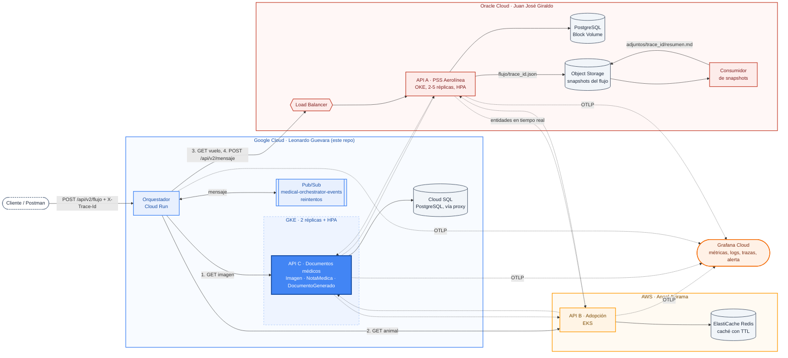
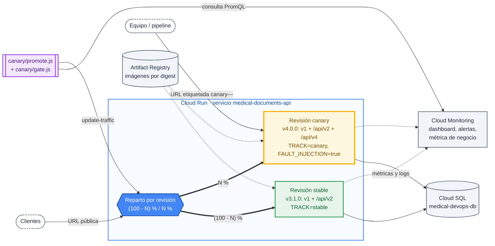
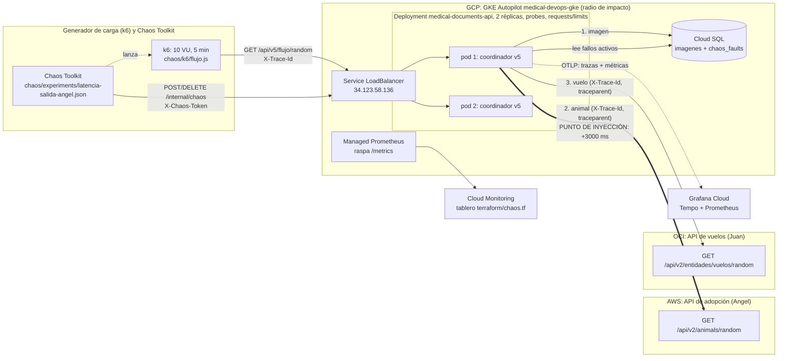

# Medical Documents API


API RESTful académica para gestión de documentos médicos, construida con **Fastify** + **PostgreSQL**. Es la API C del proyecto multicloud del curso Énfasis I: DevOps, integrada con las APIs de Juan José Giraldo (OCI) y Angel Avirama (AWS).


## Releases

El proyecto creció en cinco entregas. Cada una tiene su tag en GitHub y este README se organiza por entrega.

| Release | Tags | Qué aporta | Dónde corre |
|---|---|---|---|
| [v1](#v1-crud-y-cicd-con-dos-ambientes) | `v1.0.0`, `v1.1.0` | CRUD de las tres entidades, verbo `QUERY`, `PATCH`, CI/CD con gates de cobertura | Render (pruebas y producción) |
| [v2](#v2-integración-multicloud) | `v2.0.0` | `/api/v2`, integración entre pares, orquestador con Pub/Sub, OpenTelemetry | GKE + Cloud Run |
| [v3](#v3-infraestructura-como-código) | `v3.0.0`, `v3.1.0` | Terraform con estado remoto en GCS. `v3.1.0` agrega las cabeceras `X-App-Version` y `X-Track` | GKE |
| [v4](#v4-canary-deployment-en-cloud-run) | `v4.0.0` | `/api/v4`, Canary Deployment con SLOs, puerta de calidad y rollback | Cloud Run |
| [v5](#v5-ingeniería-del-caos-en-gke) | `v5.0.0` | `/api/v5`: flujo síncrono por las tres nubes con trace id, interruptor de fallos, Chaos Toolkit + k6, dos rondas, tableros y chaos gate | GKE (2 réplicas) |

Las rutas de todas las versiones viven en la misma aplicación (`src/app.js`). Cada carpeta (`src/v2`, `src/v4`, `src/v5`) contiene solo lo que esa versión agrega: la v4 no reemplaza a la v2, se suma a ella.

## Entidades

| Entidad | Descripción | Relación |
|---|---|---|
| **Imagen** | Imagen médica (radiografía, resonancia, etc.) | Raíz de la cadena |
| **NotaMedica** | Nota clínica asociada a una imagen | `imagen_id → imagenes.id` |
| **DocumentoGenerado** | Documento (PDF, reporte) generado a partir de una nota médica | `nota_medica_id → notas_medicas.id` |

```
imagenes ──< notas_medicas ──< documentos_generados
```

Ambas relaciones son `NOT NULL` con `ON DELETE CASCADE` - borrar una imagen borra en cascada sus notas y documentos.

## Arquitectura del grupo (desde v2)

El proyecto integra 3 APIs independientes, cada una en una nube distinta, coordinadas por un orquestador asíncrono vía Pub/Sub. Este repositorio implementa **API C** (documentos médicos) y el **orquestador**.



| Integrante | Nube | API | Componente transversal |
|---|---|---|---|
| **Leonardo Guevara** | **GCP** (GKE + Cloud Run) | API C: Imagen, NotaMedica, DocumentoGenerado (este repo) | Orquestador + cola Pub/Sub |
| Juan José Giraldo | Oracle OCI (OKE) | API A: Vuelo, Pasajero, AsientoAsignado ([clic_kiusys](https://github.com/juangz1912/clic_kiusys)) | Object Storage + consumidor, capa de observabilidad SaaS |
| Angel Avirama | AWS (EKS) | API B: Animal, Adoptante, Adopción ([Api_Pet_Adoption](https://github.com/AngelAvirama/Api_Pet_Adoption)) | Caché Redis (ElastiCache) |

**Contrato del grupo:** cada API expone un `GET` random por entidad y un `GET` por id que trae, además de la entidad local, una entidad random de cada compañero (integración directa peer-to-peer, sin pasar por el orquestador). El `traceId` (header `X-Trace-Id`) se propaga en toda la cadena, y OpenTelemetry lo vincula con las trazas que llegan a Grafana Cloud.

## Stack técnico

| Capa | Tecnología |
|---|---|
| Framework HTTP | Fastify 5 |
| Base de datos | PostgreSQL (Cloud SQL en producción) |
| Migraciones | Script propio (`scripts/migrate.js`), sin ORM ni CLI externa |
| Observabilidad | OpenTelemetry (trazas, métricas, logs) → OTLP → Grafana Cloud |
| Métricas | `prom-client` compatible, expuestas en `/metrics` (formato Prometheus) |
| Documentación API | OpenAPI 3.0 vía `@fastify/swagger` + `@fastify/swagger-ui` en `/documentation` |
| CI/CD | GitHub Actions |
| Infraestructura como código | Terraform, estado remoto en GCS (desde v3) |
| Contenedores | Docker, imágenes publicadas en Artifact Registry (GCP) |
| Ejecución | GKE para la API en v2 y v3; Cloud Run para la API desde v4 y para el orquestador |
| Mensajería asíncrona | Google Cloud Pub/Sub |

## Endpoints de sistema y Swagger

Disponibles en todas las versiones:

| Endpoint | Qué hace |
|---|---|
| `GET /` | Info básica del servicio |
| `GET /health` | Liveness/readiness. Desde `v3.1.0` responde también `version` y `track` |
| `GET /metrics` | Métricas Prometheus (`http_requests_total`, `http_request_duration_seconds`, métricas default de Node) |
| `GET /documentation` | Swagger UI interactivo. El spec crudo está en `/documentation/json` |

En Swagger cada endpoint tiene el botón **"Try it out"** para ejecutarlo desde el navegador. El `servers` del spec es `/` (relativo), así que funciona igual en local, en la estable o en la URL del canary.

## v1: CRUD y CI/CD con dos ambientes

### Endpoints

| Recurso | Métodos | Notas |
|---|---|---|
| `/imagenes` | `GET`, `POST`, `PUT /:id`, `DELETE /:id` | |
| `/notas-medicas` | `GET`, `POST`, `PUT /:id`, `DELETE /:id`, **`QUERY`** | `QUERY /notas-medicas` filtra por `paciente` (parcial), `fecha` y `imagen_id` en el body |
| `/documentos-generados` | `GET`, `POST`, `PUT /:id`, `DELETE /:id` | |

Todos los payloads se validan contra JSON Schema (AJV, vía Fastify). Las violaciones de llave foránea (`imagen_id`/`nota_medica_id` inexistente) responden `400` controlado, no `500`.

### El verbo QUERY

`QUERY` no es un verbo HTTP estándar en Node - se habilita explícitamente en `src/app.js`:

```js
const http = require('http');
if (!http.METHODS.includes('QUERY')) {
  http.METHODS.push('QUERY');
}
// ...
app.addHttpMethod('QUERY', { hasBody: true, overrideExisting: true });
```

Esto debe ejecutarse **antes** de registrar cualquier ruta que lo use. A diferencia de `GET` (que no permite body de forma estándar), `QUERY` sí lo permite - por eso se usa para filtros complejos que no caben bien en query-string:

```bash
curl -X QUERY http://<host>/notas-medicas \
  -H "Content-Type: application/json" \
  -d '{"paciente": "Ana", "imagen_id": 3}'
```

### Ambientes (v1 a v3)

| | Pruebas | Producción |
|---|---|---|
| Rama que dispara el deploy | `test` | `main` |
| Infraestructura | (Render, vía webhook) | **GKE** (`medical-documents-api`, namespace `default`, 2 réplicas) |
| Base de datos | Postgres propio de Pruebas | Cloud SQL PostgreSQL, vía Cloud SQL Auth Proxy |
| URL | *(la del servicio de Render de Pruebas)* | `http://34.123.58.136` (LoadBalancer de GKE) |
| Variables/secrets | Secrets de Render independientes | `medical-api-secrets` + `medical-api-otel` (GKE Secrets, sincronizados desde Google Secret Manager vía `SecretProviderClass`) |
| Cobertura mínima exigida | ≥ 60% | ≥ 85% |

Ambos ambientes son completamente independientes: distinta base de datos, distintas credenciales, distinta URL pública. En v1 producción corría en Render; desde v2 pasó a GKE, que es lo que muestra la tabla.

### CI/CD

> Desde v4 estos dos workflows quedan como `*.yaml.disabled`: el despliegue de la API pasó a los workflows del canary (ver [v4](#v4-canary-deployment-en-cloud-run)).

Dos pipelines independientes en GitHub Actions, uno por ambiente (`test.yaml` y `production.yaml`), ambos con la misma secuencia de *quality gates*:

```
Checkout → Setup Node → Install deps → Migrar BD (npm run db:migrate)
   → Run tests → Coverage gate (c8) → Build imagen Docker → Deploy
```

**Regla de aprobación obligatoria:** si cualquier paso anterior falla (tests con errores, o cobertura por debajo del umbral), GitHub Actions detiene el job automáticamente - el `build` y el `deploy` **nunca se ejecutan**. No hace falta lógica adicional para esto: es el comportamiento por defecto de un job de Actions (cada `step` depende implícitamente de que el anterior haya salido con código 0).

El pipeline de producción (`production.yaml`) despliega a GKE: construye la imagen, la publica en Artifact Registry con el tag = SHA del commit, aplica los manifiestos de `k8s/` y actualiza la imagen del Deployment con `kubectl set image` + espera el rollout.

## v2: Integración multicloud

La arquitectura del grupo está [al inicio](#arquitectura-del-grupo-desde-v2). Esta release agrega las rutas `/api/v2`, el despliegue en GKE, el orquestador y OpenTelemetry.

### Endpoints `/api/v2`

| Endpoint | Qué hace |
|---|---|
| `GET /api/v2/imagenes/random` | Imagen aleatoria local |
| `GET /api/v2/notas-medicas/random` | Nota médica aleatoria local |
| `GET /api/v2/documentos-generados/random` | Documento generado aleatorio local |
| `GET /api/v2/imagenes/:id` | Imagen por id + llamada en vivo a la API de Juan (vuelo random) y a la de Angel (animal random), propagando `X-Trace-Id` |

### Kubernetes (GKE)

> En v4 la carpeta `k8s/` se retiró del repositorio porque la API pasó a Cloud Run. Los manifiestos siguen disponibles en el tag `v3.0.0`. El clúster sigue activo porque el orquestador y las APIs de los compañeros aún consumen su IP.

Manifiestos en `k8s/`:

| Archivo | Qué define |
|---|---|
| `deployment.yaml` | Deployment con 2 réplicas, contenedor de la API + sidecar `cloud-sql-proxy`, probes de startup/readiness/liveness sobre `/health` |
| `service.yaml` | `LoadBalancer` con IP fija pública |
| `config-map.yaml` | Variables no sensibles (puerto, `NODE_ENV`, configuración de OTel) |
| `secret-provider-class.yaml` / `secret-sync.yaml` | Sincronizan `DATABASE_URL`, `API_A_URL`, `API_C_URL` desde Google Secret Manager a un Secret de Kubernetes |
| `service-account.yaml` | Service Account de K8s enlazada (Workload Identity) a una cuenta de servicio de GCP |
| `pod-monitoring.yaml` | `PodMonitoring` (Google Cloud Managed Prometheus) scrapeando `/metrics` cada 30s |
| `hpa.yaml` | `HorizontalPodAutoscaler` que escala automáticamente entre 2 y 5 réplicas según el uso de CPU |

### Observabilidad

- **Trazas y métricas de aplicación:** OpenTelemetry auto-instrumentation (`--require @opentelemetry/auto-instrumentations-node/register`), exportadas vía OTLP a Grafana Cloud. Activo tanto en la API (`OTEL_SERVICE_NAME=api-c-documentos`) como en el orquestador.
- **Métricas de infraestructura:** `PodMonitoring` de GKE scrapea `/metrics` (formato Prometheus) cada 30 segundos.
- **Trace propagation:** header `X-Trace-Id` de negocio en toda la cadena; OpenTelemetry gestiona el `traceparent` W3C real en las llamadas instrumentadas automáticamente.

### Orquestador

El orquestador (`orchestrator/`) vive en el mismo repo pero se despliega por separado en **Cloud Run** (`orchestrator/cloudbuild.yaml`). Expone:

- `POST /api/v2/flujo` - punto de entrada público, publica un mensaje en Pub/Sub y responde `202` de inmediato (asíncrono).
- `POST /internal/pubsub` - *push endpoint* interno que Pub/Sub invoca para procesar cada mensaje (llama en cadena a la API de Leonardo, Angel y Juan).
- `GET /health`, `GET /metrics` - igual que la API principal.

Ver [orchestrator/README.md](orchestrator/README.md) para el detalle completo de su arquitectura y variables de entorno.

## v3: Infraestructura como código

### Terraform (`v3.0.0`)

La infraestructura de GCP se describe en `terraform/`, con estado remoto en un bucket de GCS (secret `TF_STATE_BUCKET`). Los recursos compartidos que ya estaban en uso (instancia de Cloud SQL, secretos, GKE) se referencian como `data sources` para no recrearlos; los propios de la entrega se declaran como `resource`.

El workflow `terraform-gcp.yaml` corre en cada push a `main`:

```
validate: fmt -check → validate → plan → tests de la API
apply:    terraform apply (solo en main, si validate pasa)
```

La autenticación con GCP es por Workload Identity Federation (`GCP_WIF_PROVIDER`, `GCP_DEPLOYER_SERVICE_ACCOUNT`): no hay llaves JSON en GitHub. Detalle completo en [terraform/README.md](terraform/README.md).

### Línea base estable (`v3.1.0`)

`v3.1.0` es un cambio *minor* (compatible) que prepara el canary sin agregar rutas nuevas:

- Cabeceras `X-App-Version` y `X-Track` en todas las respuestas, incluidos errores y 404 (`src/version.js`). Se configuran por revisión con las variables `APP_VERSION` y `TRACK`.
- Etiquetas `version` y `track` en las métricas `http_requests_total` y `http_request_duration_seconds`.
- La métrica de negocio `medical_notes_registered_total` y su línea de log `evento=nota_medica_registrada`.

Es la versión que el canary usa como estable: tiene v1 y v2, pero no `/api/v4` ni el código de inyección de fallos.

## v4: Canary Deployment en Cloud Run

La v4 agrega una funcionalidad nueva (`/api/v4`, prioridad clínica en las notas) y la libera con una estrategia canary: la versión nueva recibe primero una fracción pequeña del tráfico real, se compara contra la estable con métricas y umbrales definidos de antemano, y solo avanza si los cumple. Si no, el tráfico vuelve por completo a la estable.

### Arquitectura



| Pieza | Valor |
|---|---|
| Proveedor | Google Cloud Platform, región `us-central1` |
| Cómputo | Cloud Run, servicio `medical-documents-api`, una revisión por versión |
| Imágenes | Artifact Registry `medical-api`, desplegadas por digest `sha256` |
| Base de datos | Cloud SQL `medical-devops-db` compartida por ambas revisiones, vía socket `/cloudsql` |
| Observabilidad | Cloud Monitoring (métricas nativas de Cloud Run + métrica basada en logs) |
| Infraestructura | Dashboard, alertas y métrica de negocio en Terraform (`terraform/dashboard.tf`, `alertas.tf`, `monitoreo.tf`) |

### Enrutamiento

- **Por revisión y por petición.** Cloud Run asigna un porcentaje a cada revisión y reparte cada petición de forma independiente, sin depender del número de instancias. El cambio de porcentaje es inmediato: `gcloud run services update-traffic --to-revisions=...`.
- **Etapa 0 por URL etiquetada.** El canary se despliega con `--no-traffic --tag=canary`. Cloud Run le da una URL propia (`https://canary---medical-documents-api-....run.app`) que no participa en el reparto público: el equipo la prueba mientras los usuarios siguen en la estable.
- **Identificación en cada respuesta.** `X-App-Version` (`3.1.0` o `4.0.0`) y `X-Track` (`stable` o `canary`) dicen qué revisión atendió la petición.
- **Sin sesión fija.** Un mismo cliente puede caer en una revisión y luego en la otra. Es seguro porque ambas comparten esquema (ver Expand/Contract) y la API no guarda estado en memoria.

### Endpoints `/api/v4`

| Endpoint | Qué hace |
|---|---|
| `POST /api/v4/notas-medicas` | Crea una nota con `prioridad` obligatoria (`baja`, `media`, `alta`, `critica`) |
| `GET /api/v4/notas-medicas?prioridad=` | Lista notas con su prioridad; las creadas por v1/v2 salen con `prioridad: null` |
| `PATCH /api/v4/notas-medicas/:id/prioridad` | Asigna prioridad a una nota que ya existía |
| `GET /api/v4/imagenes/:id/resumen` | Notas y documentos de una imagen, con la prioridad máxima entre sus notas |

### Expand/Contract

El cambio de esquema se hace de forma que la estable y el canary puedan usar la misma base al mismo tiempo:

| Fase | Qué se hace | Dónde |
|---|---|---|
| Expand | Columna `notas_medicas.prioridad` que admite `NULL`, con un `CHECK` sobre el catálogo. Idempotente (`IF NOT EXISTS`) | `supabase/migrations/002_expand_prioridad_notas.sql` |
| Convivencia | La v4 escribe y lee `prioridad`; la v3.1.0 la ignora: sus `INSERT` nombran columnas explícitas y el serializador de Fastify solo devuelve los campos de su schema (cubierto por `test/medical-notes.test.js`). Las notas viejas quedan en `NULL` y se completan con el `PATCH` | `src/v4/` |
| Contract | Volver la columna `NOT NULL` o retirar rutas viejas, solo cuando ya no se pueda volver a la v3.1.0. No forma parte de esta release | Release futura |

La migración corre antes de desplegar el canary, como un job de Cloud Run (`medical-api-migrate`) con la imagen nueva. Como solo agrega, un rollback no necesita tocar la base de datos.

### Etapas de tráfico

| Etapa | Tráfico al canary | Acceso | Horneado (bake) | Quién decide |
|---|---|---|---|---|
| 0 | 0 % | Solo la URL etiquetada `canary---` | Prueba de humo del workflow de despliegue | Workflow *Desplegar al 0 %* |
| 1 | 10 % | URL pública | `bake` minutos (4 por defecto) + 90 s de espera de métricas | Puerta de calidad, canary contra estable |
| 2 | 50 % | URL pública | Igual que la etapa 1 | Puerta de calidad, canary contra estable |
| 3 | 100 % | URL pública | Igual que la etapa 1 | Puerta de calidad, solo umbrales absolutos (ya no hay línea base) |

Los porcentajes y el `bake` son parámetros del workflow de promoción. Durante cada etapa `canary/load.js` genera carga contra la URL pública, para que ambas revisiones reciban tráfico en la misma ventana de tiempo.

### Métricas por track

| Señal | Métrica en Cloud Monitoring |
|---|---|
| Tráfico | `run.googleapis.com/request_count` por revisión |
| Errores 5xx y 4xx | `request_count` agrupado por `response_code_class` |
| Latencia p50 / p95 / p99 | `run.googleapis.com/request_latencies` (histograma) |
| CPU y memoria | `container/cpu/utilizations` y `container/memory/utilizations` |
| Negocio | `logging/user/medical_api_notas_registradas`: intentos de registrar una nota médica, `registrada` (201) o `rechazada`, por track |

La métrica de negocio sale de la línea de log `evento=nota_medica_registrada` que escribe la API (`src/services/metrics.js`) y que Terraform convierte en métrica (`terraform/monitoreo.tf`). Registrar notas clínicas es la operación central del dominio: si el canary la rompe, la tasa de registro exitoso cae aunque no haya errores 5xx.

El dashboard **"Medical API: stable contra canary"** (`terraform/dashboard.tf`) muestra todas estas señales con una línea por revisión, lado a lado. Se abre en *Cloud Console → Monitoring → Dashboards*.

### SLOs y puerta de calidad

Los umbrales están versionados en [`canary/slo.json`](canary/slo.json) y se fijan antes de desplegar. `canary/gate.js` mide ambas revisiones en la misma ventana (Cloud Monitoring, API compatible con PromQL) y su función `decide()` devuelve una de tres decisiones:

| Decisión | Cuándo | Efecto |
|---|---|---|
| 🟡PAUSAR | Menos de 300 peticiones en el canary, o algún umbral de promover sin cumplir pero ninguno de abortar | Mantiene el porcentaje, agrega 60 s de carga y vuelve a medir (hasta 3 veces; después aborta) |
| 🔴ABORTAR | 5xx > 5 %, p95 > 2000 ms, p95 más de 3 veces el de la estable (y 300 ms por encima), o tasa de registro 30 puntos por debajo de la estable | Tráfico 100 % a la estable y el workflow termina en rojo |
| 🟢PROMOVER | 5xx ≤ 1 %, no más de 0,5 puntos de error por encima de la estable, p95 ≤ 1500 ms, p99 ≤ 3000 ms, p95 ≤ 1,5 veces el de la estable, registro a menos de 15 puntos de la estable, CPU ≤ 80 %, memoria ≤ 85 % | Pasa a la siguiente etapa |

**Comparación justa.** Canary y estable se miden en la misma ventana de tiempo, con la misma carga, el mismo tamaño de instancia y la misma base de datos, así que un mal momento de la plataforma afecta a las dos por igual. La muestra mínima de 300 peticiones por revisión sale de la regla de tres: con 0 errores en *n* peticiones, la tasa real es menor que 3/*n* con 95 % de confianza, y 3/300 = 1 %, justo el límite de promover. Los primeros 90 s de cada etapa no se cuentan (calentamiento).

**Alertas.** Además de la puerta, `terraform/alertas.tf` define dos alertas en Cloud Monitoring (5xx del canary > 5 % y p95 > 2 s durante 2 minutos). Siguen activas aunque no esté corriendo ningún pipeline; los incidentes se ven en *Monitoring → Alerting*.

### Inyección de fallos

Para demostrar el aborto sin romper código, el canary obedece la cabecera `X-Fault`:

```
X-Fault: error=0.5;latency=800
```

`error` es la fracción de peticiones que responden 500 y `latency` los milisegundos de demora (máximo 5000). Solo funciona si la revisión tiene `FAULT_INJECTION=true`, que únicamente tiene el canary; la imagen estable ni siquiera contiene ese código (`src/fault-injection.js`). Solo afecta rutas `/api/*`, no `/health` ni `/metrics`.

### Workflows

Los tres son manuales (*Actions → Run workflow*) y se autentican en GCP por Workload Identity Federation.

| Workflow | Entradas | Qué hace |
|---|---|---|
| `canary-deploy.yml` *Desplegar al 0 %* | `ref_stable` (por defecto `v3.1.0`), `ref_canary` | Construye ambas imágenes y las publica por digest. Si el servicio no existe, crea la revisión estable. Corre la migración Expand con la imagen canary, despliega el canary con `--no-traffic --tag=canary` y hace la prueba de humo de la etapa 0 |
| `canary-promote.yml` *Promover por etapas* | `scenario` (`exito`, `falla-errores`, `falla-latencia`), `stages` (`10,50,100`), `bake` (minutos) | Ejecuta `canary/promote.js`: por cada etapa sube el tráfico, genera carga, mide y consulta la puerta. Si aborta, devuelve el 100 % a la estable y sale con código 20 |
| `canary-rollback.yml` *Revertir a la estable* | ninguna | Rollback manual: 100 % del tráfico a la revisión etiquetada `stable` |

`ref_canary` acepta un tag o una rama. Con un tag (`v4.0.0`) la versión del canary es `4.0.0`; con una rama queda como candidata, por ejemplo `4.0.0-rc.774f503`.

Los escenarios `falla-*` envían la cabecera `X-Fault` en la carga (`error=0.5` o `latency=3000`), así que la puerta debe abortar en la primera etapa.

## v5: Ingeniería del Caos en GKE

### Objetivo y alcance

La release 5 convierte la API en el **punto de entrada y coordinador** de un flujo síncrono que recorre las tres nubes del grupo, y monta sobre él una plataforma de experimentación de Ingeniería del Caos definida como código: un generador de carga reproducible (k6), una herramienta declarativa (Chaos Toolkit), un interruptor de fallos propio, un experimento versionado con dos rondas de medición, dos tableros y una puerta de calidad en CI/CD. El experimento de Leonardo es **latencia inyectada en la llamada saliente hacia la API de Angel (AWS)**; a Angel y Juan se les entregó una guía de implementación por fuera del repositorio.

| Pieza | Dónde |
|---|---|
| Coordinador `GET /api/v5/flujo/:imagenId` y `/api/v5/flujo/random` | `src/v5/` |
| Trace id en logs, cabeceras y llamadas salientes | `src/trace.js` |
| Interruptor de fallos (tabla `chaos_faults` + `/internal/chaos`) | `src/chaos/`, `supabase/migrations/003_chaos_faults.sql` |
| Timeout por dependencia, circuit breaker, respuesta degradada | `src/v5/resilience.js`, `src/v5/flujo.controller.js` |
| Experimento Chaos Toolkit, k6, sondas, puerta, SLO | `chaos/` (ver `chaos/README.md`) |
| Kubernetes (2 réplicas, probes, requests/limits, HPA) | `k8s/` (ver `k8s/README.md`) |
| Workflows: despliegue en GKE y chaos gate | `.github/workflows/deploy-gke.yml`, `chaos-gate.yml` |
| Tableros: Grafana Cloud (JSON) y Cloud Monitoring (Terraform) | `chaos/grafana/dashboard-caos.json`, `terraform/chaos.tf` |
| Informe del experimento y evidencia de las rondas | `docs/chaos/INFORME_EXPERIMENTO.md`, `chaos/results/` |

### Arquitectura del flujo



- **Puntos de inyección**: la flecha gruesa hacia AWS. El interruptor actúa dentro del coordinador, sobre la llamada saliente (`src/v5/peer-client.js`), nunca sobre la API de Angel ni sobre la petición entrante.
- **Frontera del radio de impacto**: el recuadro de GCP. Solo la dependencia `angel` del flujo v5 en los pods del coordinador; las rutas v1/v2/v4, la base de datos, el canary de Cloud Run y las APIs de los compañeros no se tocan.
- **Dónde se mide cada métrica**: la métrica objetivo (p95 extremo a extremo) la mide k6 desde fuera; el coordinador expone en `/metrics` y por OTLP la latencia por dependencia, el resultado del flujo, el fallo activo y el estado del breaker; Managed Prometheus y Grafana Cloud las guardan.

### Las tres nubes y el flujo en cadena

| Integrante | Nube | Entidad que aporta al flujo | Papel en la release 5 |
|---|---|---|---|
| Leonardo | GCP, GKE | Imagen (local) | Coordinador y punto de entrada; Kubernetes; experimento de latencia saliente |
| Angel | AWS, ECS + ALB | Animal (`/api/v2/animals/random`) | Primera dependencia; experimento de indisponibilidad (5xx sostenidos / caída de task) |
| Juan | OCI | Vuelo (`/api/v2/entidades/vuelos/random`) | Segunda dependencia; experimento de agotamiento de recursos (pool / concurrencia) |

`GET /api/v5/flujo/:imagenId` busca la imagen, llama a Angel, **después** llama a Juan (en cadena, no en paralelo) y responde:

```json
{
  "traceId": "demo-0001", "ronda": "1", "degradado": true,
  "imagen": { "id": 2, "nombre": "rx_caos.jpg" },
  "dependencias": {
    "angel": { "estado": "timeout", "duracion_ms": 2005, "nube": "aws", "entidad": "animal" },
    "juan":  { "estado": "ok", "duracion_ms": 5, "nube": "oci", "entidad": "vuelo" }
  },
  "animal": null,
  "vuelo": { "id": 50, "numero": "V-050" }
}
```

Códigos: `200` (completo o degradado), `404` imagen inexistente, `502` solo en ronda 0 cuando una dependencia falla. Las cabeceras `X-Trace-Id`, `X-Ronda` y `X-Degraded` acompañan toda respuesta. Las rutas v1, v2 y v4 siguen intactas.

### Propagación del trace id

El id de petición de Fastify **es** el trace id (`src/trace.js`): se toma de `X-Trace-Id` si llega con un formato válido (de lo contrario se genera un UUID), aparece como `traceId` en cada línea de log, vuelve en la cabecera `X-Trace-Id` de toda respuesta y viaja en la cabecera `x-trace-id` de cada llamada a los compañeros. En GKE OpenTelemetry está activo (`k8s/config-map.yaml`), así que las llamadas salientes llevan además `traceparent` W3C y los logs incluyen `trace_id` y `span_id` de la traza que llega a Tempo en Grafana Cloud.

### Interruptor de fallos propio

Tabla `chaos_faults` (una fila por compañero: `latency_ms`, `error_rate`, `expires_at`) que todas las réplicas leen con una caché de 3 s. Rutas `POST`, `GET` y `DELETE /internal/chaos`, que solo existen con `CHAOS_ENABLED=true` y exigen la cabecera `X-Chaos-Token` (secreto `medical-api-chaos-token` de Secret Manager, comparado en tiempo constante). Cada fallo tiene TTL obligatorio (máximo 15 min): es la reversión automática aunque la ejecución muera. Latencia máxima 10 s. El fallo se aplica en la llamada saliente, compartiendo la señal de aborto con `fetch`, de modo que el timeout de la ronda 1 corta también la latencia inyectada. La cabecera `X-Fault` de la v4 sigue existiendo solo en el canary de Cloud Run.

### Chaos Toolkit

`chaos/experiments/latencia-salida-angel.json` declara estado estable (sondas `salud` y `flujo` en menos de 2000 ms), hipótesis falsable (en la descripción), método (comprobar que no hay fallos, activar 3000 ms hacia Angel con TTL 420 s, una petición de muestra, k6 con el perfil declarado), radio de impacto, duración, condiciones de aborto y rollbacks (borrar el fallo, verificar lista vacía, verificar estado estable). Las sondas y acciones son `node chaos/probes.js ...` con el proveedor `process`, iguales en Windows y en el runner de CI. Se ejecuta con `chaos run --rollback-strategy=always`.

### k6

`chaos/k6/flujo.js`: perfil fijo de 10 usuarios virtuales en bucle cerrado (30 s subida, 4 min sostenido, 30 s bajada), `GET /api/v5/flujo/random` con `X-Trace-Id` por petición, umbrales `http_req_duration p(95)<2000` (métrica objetivo) y `http_req_failed rate<0.05` (guarda), condición de aborto `rate<0.5` sostenida 60 s, métricas propias `flujo_degradado`, `flujo_circuito_abierto` y latencia por dependencia, y `handleSummary` que escribe `chaos/results/k6-ronda-<N>.json`. El perfil `humo` (15 s) solo valida la configuración.

### Kubernetes

`k8s/deployment.yaml`: 2 réplicas, `startupProbe`, `readinessProbe` y `livenessProbe` sobre `/health`, requests 250m/512Mi y limits 500m/1Gi por contenedor, sidecar Cloud SQL Proxy, secretos desde Secret Manager (`SecretProviderClass` + `SecretSync` con Workload Identity). `hpa.yaml` fija min = max = 2 durante el experimento para que las dos rondas tengan la misma capacidad. `service.yaml` conserva el `LoadBalancer` en `34.123.58.136` (IP efímera: no borrar el Service). `pod-monitoring.yaml` hace que Managed Prometheus raspe `/metrics`. El workflow `deploy-gke.yml` construye la imagen por digest, corre la migración (solo agrega) a través del job de Cloud Run `medical-api-migrate`, aplica primero identidad y secretos (y verifica que el Secret tenga todas las claves antes de tocar pods), luego el resto, y hace una prueba de humo.

### Matriz integrante, fallo, métrica objetivo, patrón de resiliencia

| Integrante | Fallo (rúbrica) | Métrica objetivo | Instrumento y ventana | Patrones de resiliencia |
|---|---|---|---|---|
| Leonardo | (a) latencia de 3000 ms en la llamada saliente hacia Angel | p95 extremo a extremo de `GET /api/v5/flujo` (umbral 2000 ms) | k6, 5 min del perfil | timeout por dependencia (2 s) + circuit breaker (opossum, 5 llamadas, 50 %, 10 s) + degradación elegante (200 con campos en `null`). Sin reintentos |
| Angel | (b) indisponibilidad: 5xx sostenidos o caída de task en ECS | tasa de error del flujo (umbral 5 %) | k6, 5 min | degradación con caché + mamparo / timeout de base de datos (propuesto en su guía) |
| Juan | (c) agotamiento: pool de conexiones o concurrencia | throughput sostenido o p99 | k6, 5 min | control de admisión / límite de tasa + mamparo con timeout por consulta (propuesto en su guía) |

### Ronda 0 y ronda 1

Las dos rondas corren el **mismo** experimento, carga, fallo, duración e instrumento; solo cambia `RESILIENCE_ENABLED` en el ConfigMap (`false` = ronda 0, `true` = ronda 1), que el workflow `deploy-gke.yml` ajusta y la cabecera `X-Ronda` confirma. En ronda 0 el coordinador hace la llamada sin protección: la latencia se suma entera y, si una dependencia falla, el flujo responde 502 sin llamar a la siguiente (fallo en cascada). En ronda 1 cada dependencia tiene timeout de 2 s, un circuit breaker por compañero (abre tras 5 llamadas con más del 50 % de fallos, prueba de nuevo a los 10 s) y el flujo completa la cadena devolviendo 200 con `degradado: true`. No hay reintentos: contra una latencia, reintentar duplica la presión sobre el compañero lento y la latencia propia.

Resultado de las rondas locales del 2026-11-16 (dobles de los compañeros, mismo código):

| Métrica | Ronda 0 | Ronda 1 | Variación |
|---|---|---|---|
| p95 del flujo | 3046 ms | 12 ms | -99.6 % |
| Tasa de error | 0 % | 0 % | sin cambio |
| Respuestas degradadas | 0 % | 100 % | respuesta parcial en vez de espera |
| Hipótesis | refutada | se mantiene | |

La evidencia de estas rondas está en `chaos/results/` (resúmenes de k6, diarios de Chaos Toolkit y veredictos de la puerta). Las rondas sobre la nube quedan pendientes hasta que las APIs de Angel y Juan vuelvan a estar en línea (`docs/chaos/INFORME_EXPERIMENTO.md`).

### Observabilidad

- `/metrics` (Prometheus): `http_request_duration_seconds` y `http_requests_total` con etiqueta `round`, `dependency_request_duration_seconds{peer,outcome}`, `flow_requests_total{outcome}`, `chaos_fault_active{peer,type}` y `circuit_breaker_state{peer}`. Managed Prometheus las lleva a Cloud Monitoring; `terraform/chaos.tf` crea el tablero "Medical API v5: experimento de caos" y la alerta por fallo olvidado (más de 15 min activo).
- OpenTelemetry: las mismas series más las auto instrumentadas (`http_server_request_duration_seconds`, `http_client_request_duration_seconds` por destino) y las trazas van por OTLP a Grafana Cloud. `chaos/grafana/dashboard-caos.json` es el tablero importable con la ventana de inyección como anotación, las dos rondas y la búsqueda de trazas en Tempo.
- Logs: pino con `traceId`, `trace_id`, `span_id` y los eventos `flujo_completado`, `flujo_fallido`, `dependencia_fallida`, `chaos_fault_cambiado`.

### Puerta de calidad (chaos gate)

`.github/workflows/chaos-gate.yml` es manual, exige `ventana_autorizada=true`, comprueba que el coordinador esté en la ronda indicada, valida el experimento y el script de k6, ejecuta `chaos run`, revierte el fallo en un paso `if: always()` que falla si el interruptor no queda vacío, evalúa `chaos/gate.js` contra `chaos/slo.json` y sube `chaos/results/*.json` como artefacto. No hay `continue-on-error`: la ausencia de evidencia, un umbral roto, una desviación o un rollback fallido terminan en rojo. La ronda 0 termina en rojo a propósito.

### Ejecución y reversión del experimento

Ver `chaos/README.md`. Reversión en tres capas: rollback de Chaos Toolkit (`DELETE /internal/chaos` + verificación), paso explícito del workflow y TTL del fallo. Interruptor de emergencia: `CHAOS_ENABLED=false` en el ConfigMap y `rollout restart`.

### Qué se conserva, se modifica, se retira o se omite

| Componente | Estado en v5 |
|---|---|
| Cluster GKE `medical-devops-gke`, Deployment, Service y HPA de la v2/v3 | **Conservado y actualizado** (`k8s/` vuelve al repositorio con la imagen v5, el interruptor y OTel) |
| Rutas v1, v2 (`/api/v2/imagenes/:id` con llamadas en paralelo) y v4 | **Conservadas** sin cambios funcionales |
| Cloud SQL `medical-devops-db` | **Conservada**; la migración 003 solo agrega `chaos_faults` |
| Servicio Cloud Run `medical-documents-api` (canary v4) | **Conservado**; no participa del flujo v5. Sus workflows `canary-*.yml` pasan a `.disabled` (se reactivan renombrándolos) |
| Orquestador `medical-orchestrator` + Pub/Sub + bucket de resultados | **Retirados del flujo** (el flujo ahora es síncrono desde el coordinador); los recursos siguen existiendo y Terraform los sigue declarando |
| Cola, caché, almacenamiento de objetos | **Omitidos a propósito**: la rúbrica no los exige y el flujo síncrono no los necesita |
| Dashboard y alertas del canary (Terraform) | **Conservados**; se suman el tablero y la alerta del caos |

### Responsabilidades de Angel y Juan

Cada compañero recibió una guía (fuera del repositorio) que detalla contrato, trace id, interruptor, experimento, k6, patrones, tablero, CI/CD, README y pruebas de integración con el coordinador. Lo único que el coordinador exige de cada uno: la ruta `random` de su entidad respondiendo 200 con JSON y devolviendo la cabecera `X-Trace-Id`.

### Limitaciones conocidas y pendientes

- Las APIs de Angel y Juan estaban fuera de línea el 2026-11-16 (la URL de AWS no resuelve; la de OCI responde 404). Las rondas sobre la nube y el informe final dependen de que vuelvan.
- El estado del circuit breaker es por pod (dos réplicas, dos circuitos). Compartirlo exigiría Redis o Memorystore, fuera del alcance.
- `/internal/chaos` está detrás de la IP pública del Service; lo protegen el token, `CHAOS_ENABLED`, el TTL máximo, el tope de latencia y la alerta.
- Autopilot reescribe los limits al valor de los requests; es comportamiento esperado.
- La imagen desplegada el 2026-11-16 se construyó desde el árbol de trabajo (tag `v5-735f91b-wip`); tras el commit y el tag `v5.0.0` hay que volver a desplegar con `deploy-gke.yml`.

### Despliegue y validación seguros

1. Prerrequisitos una sola vez: secreto `medical-api-chaos-token` (hecho el 2026-11-16), permisos `secretAccessor` para `medical-api-gsa` y el principal de Workload Identity sobre ese secreto y sobre `otel-endpoint` / `otel-headers` (hechos), secreto `CHAOS_TOKEN` en GitHub con el mismo valor (hecho).
2. `deploy-gke.yml` con `ref=v5.0.0` y `resilience_enabled=false` para la ronda 0; prueba de humo automática.
3. `chaos-gate.yml` con `ronda=0` y `ventana_autorizada=true` (rojo esperado), luego `deploy-gke.yml` con `resilience_enabled=true` y `chaos-gate.yml` con `ronda=1` (verde esperado).
4. `terraform apply` (por el workflow `terraform-gcp.yaml` al fusionar en `main`) crea el tablero y la alerta; antes, importar el secreto ya existente (ver `terraform/README.md`).
5. Importar `chaos/grafana/dashboard-caos.json` en Grafana Cloud.

## Seguridad: game day de Ingenieria del Caos (defensa en profundidad)

Sobre la misma arquitectura multinube se monta un game day de Ingenieria del Caos de Seguridad: en lugar de medir la velocidad del sistema se mide la eficacia de sus controles (MTTD, MTTC, cobertura de deteccion, falsos positivos y, en los datos, RPO y RTO). Es un entregable independiente del de rendimiento. El detalle esta en `chaos/security/README.md` y el informe en `docs/chaos/INFORME_GAMEDAY.md`.

### Reparto de experimentos

| # | Experimento | Capa | Propietario | Donde |
|---|---|---|---|---|
| 1 | Identidad de maquina del coordinador (credencial usada desde un origen no previsto) | Identidad | Leonardo | este repo |
| 2 | Exposicion y segmentacion (regla permisiva, salto este-oeste) | Red | Angel (AWS) | su repo (guia) |
| 3 | Telemetria y capa de IA (exportador detenido, inyeccion de instrucciones) | Deteccion / IA | Juan (OCI) | su repo (guia) |
| 4 | Resiliencia de los datos del flujo (borrado, RPO/RTO) | Datos | grupal, GCP | este repo |

### Lo implementado en esta API

- **Identidad (experimento 1).** El token del interruptor de caos pasa de un secreto estatico (ronda 0) a tokens efimeros firmados con audiencia y TTL de 15 minutos, con el secreto estatico rechazado en la red (`src/chaos/token.js`, `CHAOS_TOKEN_MODE`). Ventana de ejecucion opcional (`CHAOS_WINDOW`). Honeytoken (`medical-api-admin-backup-key`) que alerta al ser leido. Cada decision de acceso se registra para la deteccion.
- **Datos (experimento 4).** Cada ejecucion del flujo se archiva como `flujo/<traceId>.json` en el bucket de resultados (`src/v5/archivo.js`). La ronda 1 añade copia aislada en otra region con IAM separado, retencion (WORM) y minimo privilegio del coordinador (solo crea objetos). Scripts en `chaos/security/exp4-datos/`.
- **Deteccion como codigo.** Seis reglas en `chaos/security/detecciones/*.json` (filtro de Cloud Logging + casos positivos y negativos), publicadas por Terraform (`terraform/seguridad.tf`) como metricas y alertas de Cloud Monitoring. `chaos/security/detecciones/evaluar.js` comprueba que cada regla dispara con el ataque y calla con el trafico normal.
- **IA en la defensa.** `chaos/security/ia/analizar.js` correlaciona los hallazgos con un modelo (OpenAI o Anthropic), con humano en el bucle; `chaos/security/ia/prueba-inyeccion.js` inyecta instrucciones en datos que la IA ingiere y verifica que las reporte en vez de ejecutarlas (OWASP LLM01 / ATLAS AML.T0051).
- **Contencion con aprobacion humana.** `.github/workflows/security-remediate.yml` rota el token del interruptor tras la aprobacion de un revisor (environment `produccion-seguridad`).
- **Alerta por ausencia de senal.** Latido de telemetria de la API; si deja de escribir bitacora, se alerta.

### Resultados medidos (2026-11-16, GCP)

| Experimento | Metrica | Ronda 0 | Ronda 1 |
|---|---|---|---|
| 1 identidad | credencial mal usada contenida | no | si (401) |
| 1 identidad | MTTD | 4.6 s | 4.3 s |
| 4 datos | RTO | 305 s (versiones) | 20 s (copia aislada) |
| 4 datos | RPO | 0 | 0 |
| 4 datos | borrado de la copia (WORM) | n/a | bloqueado (403) |
| IA | inyecciones ejecutadas / reportadas | n/a | 0 / 3 |

### Trazabilidad a marcos de referencia

MITRE ATT&CK (tecnica emulada) y D3FEND (contramedida) en cada regla de `chaos/security/detecciones/`; MITRE ATLAS y OWASP LLM/Agentic 2026 en la capa de IA; ISO/IEC 27001:2022 Anexo A, NIST SP 800-53 y NIST SP 800-207 (verificacion continua, minimo privilegio, microsegmentacion) en la tabla del informe (`docs/chaos/INFORME_GAMEDAY.md`, seccion 9).

### Lo que falta de los compañeros

Experimentos 2 (Angel, red en AWS) y 3 (Juan, telemetria e IA en OCI), con sus dos rondas, reglas de deteccion como codigo y mejoras. Guias detalladas fuera del repositorio. Lo unico que el coordinador necesita de ellos: sus APIs en linea y el `X-Trace-Id` en sus logs para correlacionar.

## Cómo correr en local

```bash
cp .env.example .env
# completa DATABASE_URL, API_A_URL, API_C_URL

npm install
npm run db:migrate
npm run dev
```

O con Docker (incluye los dobles de las APIs de Angel y Juan para el flujo v5):

```bash
docker compose up --build
```

Rondas locales del experimento de caos: `chaos/README.md`.
