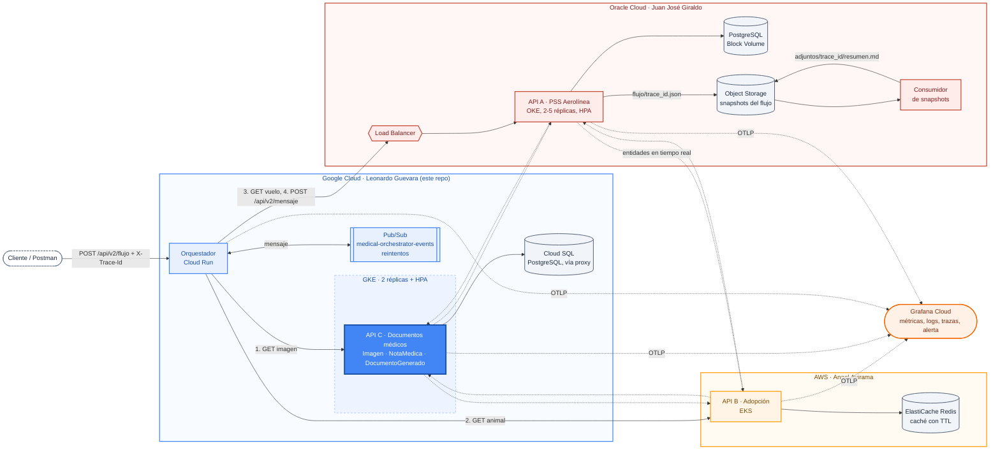
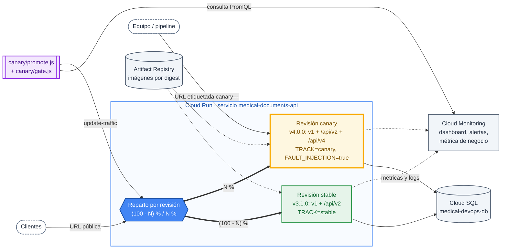

# 🩺 Medical Documents API

<p align="center">
  <a href="https://github.com/LeonardoG2005/MedicalDevops/tags"></a>
  <a href="https://github.com/LeonardoG2005/MedicalDevops/actions/workflows/terraform-gcp.yaml"></a>
  
</p>

<p align="center">
  
  
  
  
  
  
  
  
  
  
</p>

<p align="center">
  
  
  
</p>

API RESTful académica para gestión de documentos médicos, construida con **Fastify** + **PostgreSQL**. Es la API C del proyecto multicloud del curso Énfasis I: DevOps, integrada con las APIs de Juan José Giraldo (OCI) y Angel Avirama (AWS).


## Releases

El proyecto creció en cuatro entregas. Cada una tiene su tag en GitHub y este README se organiza por entrega.

| Release | Tags | Qué aporta | Dónde corre |
|---|---|---|---|
| [v1](#v1-crud-y-cicd-con-dos-ambientes) | `v1.0.0`, `v1.1.0` | CRUD de las tres entidades, verbo `QUERY`, `PATCH`, CI/CD con gates de cobertura | Render (pruebas y producción) |
| [v2](#v2-integración-multicloud) | `v2.0.0` | `/api/v2`, integración entre pares, orquestador con Pub/Sub, OpenTelemetry | GKE + Cloud Run |
| [v3](#v3-infraestructura-como-código) | `v3.0.0`, `v3.1.0` | Terraform con estado remoto en GCS. `v3.1.0` agrega las cabeceras `X-App-Version` y `X-Track` | GKE |
| [v4](#v4-canary-deployment-en-cloud-run) | `v4.0.0` | `/api/v4`, Canary Deployment con SLOs, puerta de calidad y rollback | Cloud Run |

Las rutas de todas las versiones viven en la misma aplicación (`src/app.js`). Cada carpeta (`src/v2`, `src/v4`) contiene solo lo que esa versión agrega: la v4 no reemplaza a la v2, se suma a ella.

## Entidades

| Entidad | Descripción | Relación |
|---|---|---|
| **Imagen** | Imagen médica (radiografía, resonancia, etc.) | Raíz de la cadena |
| **NotaMedica** | Nota clínica asociada a una imagen | `imagen_id → imagenes.id` |
| **DocumentoGenerado** | Documento (PDF, reporte) generado a partir de una nota médica | `nota_medica_id → notas_medicas.id` |

```
imagenes ──< notas_medicas ──< documentos_generados
```

Ambas relaciones son `NOT NULL` con `ON DELETE CASCADE` - borrar una imagen borra en cascada sus notas y documentos.

## Arquitectura del grupo (desde v2)

El proyecto integra 3 APIs independientes, cada una en una nube distinta, coordinadas por un orquestador asíncrono vía Pub/Sub. Este repositorio implementa **API C** (documentos médicos) y el **orquestador**.



| Integrante | Nube | API | Componente transversal |
|---|---|---|---|
| **Leonardo Guevara** | **GCP** (GKE + Cloud Run) | API C: Imagen, NotaMedica, DocumentoGenerado (este repo) | Orquestador + cola Pub/Sub |
| Juan José Giraldo | Oracle OCI (OKE) | API A: Vuelo, Pasajero, AsientoAsignado ([clic_kiusys](https://github.com/juangz1912/clic_kiusys)) | Object Storage + consumidor, capa de observabilidad SaaS |
| Angel Avirama | AWS (EKS) | API B: Animal, Adoptante, Adopción ([Api_Pet_Adoption](https://github.com/AngelAvirama/Api_Pet_Adoption)) | Caché Redis (ElastiCache) |

**Contrato del grupo:** cada API expone un `GET` random por entidad y un `GET` por id que trae, además de la entidad local, una entidad random de cada compañero (integración directa peer-to-peer, sin pasar por el orquestador). El `traceId` (header `X-Trace-Id`) se propaga en toda la cadena, y OpenTelemetry lo vincula con las trazas que llegan a Grafana Cloud.

## Stack técnico

| Capa | Tecnología |
|---|---|
| Framework HTTP | Fastify 5 |
| Base de datos | PostgreSQL (Cloud SQL en producción) |
| Migraciones | Script propio (`scripts/migrate.js`), sin ORM ni CLI externa |
| Observabilidad | OpenTelemetry (trazas, métricas, logs) → OTLP → Grafana Cloud |
| Métricas | `prom-client` compatible, expuestas en `/metrics` (formato Prometheus) |
| Documentación API | OpenAPI 3.0 vía `@fastify/swagger` + `@fastify/swagger-ui` en `/documentation` |
| CI/CD | GitHub Actions |
| Infraestructura como código | Terraform, estado remoto en GCS (desde v3) |
| Contenedores | Docker, imágenes publicadas en Artifact Registry (GCP) |
| Ejecución | GKE para la API en v2 y v3; Cloud Run para la API desde v4 y para el orquestador |
| Mensajería asíncrona | Google Cloud Pub/Sub |

## Endpoints de sistema y Swagger

Disponibles en todas las versiones:

| Endpoint | Qué hace |
|---|---|
| `GET /` | Info básica del servicio |
| `GET /health` | Liveness/readiness. Desde `v3.1.0` responde también `version` y `track` |
| `GET /metrics` | Métricas Prometheus (`http_requests_total`, `http_request_duration_seconds`, métricas default de Node) |
| `GET /documentation` | Swagger UI interactivo. El spec crudo está en `/documentation/json` |

En Swagger cada endpoint tiene el botón **"Try it out"** para ejecutarlo desde el navegador. El `servers` del spec es `/` (relativo), así que funciona igual en local, en la estable o en la URL del canary.

## v1: CRUD y CI/CD con dos ambientes

### Endpoints

| Recurso | Métodos | Notas |
|---|---|---|
| `/imagenes` | `GET`, `POST`, `PUT /:id`, `DELETE /:id` | |
| `/notas-medicas` | `GET`, `POST`, `PUT /:id`, `DELETE /:id`, **`QUERY`** | `QUERY /notas-medicas` filtra por `paciente` (parcial), `fecha` y `imagen_id` en el body |
| `/documentos-generados` | `GET`, `POST`, `PUT /:id`, `DELETE /:id` | |

Todos los payloads se validan contra JSON Schema (AJV, vía Fastify). Las violaciones de llave foránea (`imagen_id`/`nota_medica_id` inexistente) responden `400` controlado, no `500`.

### El verbo QUERY

`QUERY` no es un verbo HTTP estándar en Node - se habilita explícitamente en `src/app.js`:

```js
const http = require('http');
if (!http.METHODS.includes('QUERY')) {
  http.METHODS.push('QUERY');
}
// ...
app.addHttpMethod('QUERY', { hasBody: true, overrideExisting: true });
```

Esto debe ejecutarse **antes** de registrar cualquier ruta que lo use. A diferencia de `GET` (que no permite body de forma estándar), `QUERY` sí lo permite - por eso se usa para filtros complejos que no caben bien en query-string:

```bash
curl -X QUERY http://<host>/notas-medicas \
  -H "Content-Type: application/json" \
  -d '{"paciente": "Ana", "imagen_id": 3}'
```

### Ambientes (v1 a v3)

| | Pruebas | Producción |
|---|---|---|
| Rama que dispara el deploy | `test` | `main` |
| Infraestructura | (Render, vía webhook) | **GKE** (`medical-documents-api`, namespace `default`, 2 réplicas) |
| Base de datos | Postgres propio de Pruebas | Cloud SQL PostgreSQL, vía Cloud SQL Auth Proxy |
| URL | *(la del servicio de Render de Pruebas)* | `http://34.123.58.136` (LoadBalancer de GKE) |
| Variables/secrets | Secrets de Render independientes | `medical-api-secrets` + `medical-api-otel` (GKE Secrets, sincronizados desde Google Secret Manager vía `SecretProviderClass`) |
| Cobertura mínima exigida | ≥ 60% | ≥ 85% |

Ambos ambientes son completamente independientes: distinta base de datos, distintas credenciales, distinta URL pública. En v1 producción corría en Render; desde v2 pasó a GKE, que es lo que muestra la tabla.

### CI/CD

> Desde v4 estos dos workflows quedan como `*.yaml.disabled`: el despliegue de la API pasó a los workflows del canary (ver [v4](#v4-canary-deployment-en-cloud-run)).

Dos pipelines independientes en GitHub Actions, uno por ambiente (`test.yaml` y `production.yaml`), ambos con la misma secuencia de *quality gates*:

```
Checkout → Setup Node → Install deps → Migrar BD (npm run db:migrate)
   → Run tests → Coverage gate (c8) → Build imagen Docker → Deploy
```

**Regla de aprobación obligatoria:** si cualquier paso anterior falla (tests con errores, o cobertura por debajo del umbral), GitHub Actions detiene el job automáticamente - el `build` y el `deploy` **nunca se ejecutan**. No hace falta lógica adicional para esto: es el comportamiento por defecto de un job de Actions (cada `step` depende implícitamente de que el anterior haya salido con código 0).

El pipeline de producción (`production.yaml`) despliega a GKE: construye la imagen, la publica en Artifact Registry con el tag = SHA del commit, aplica los manifiestos de `k8s/` y actualiza la imagen del Deployment con `kubectl set image` + espera el rollout.

## v2: Integración multicloud

La arquitectura del grupo está [al inicio](#arquitectura-del-grupo-desde-v2). Esta release agrega las rutas `/api/v2`, el despliegue en GKE, el orquestador y OpenTelemetry.

### Endpoints `/api/v2`

| Endpoint | Qué hace |
|---|---|
| `GET /api/v2/imagenes/random` | Imagen aleatoria local |
| `GET /api/v2/notas-medicas/random` | Nota médica aleatoria local |
| `GET /api/v2/documentos-generados/random` | Documento generado aleatorio local |
| `GET /api/v2/imagenes/:id` | Imagen por id + llamada en vivo a la API de Juan (vuelo random) y a la de Angel (animal random), propagando `X-Trace-Id` |

### Kubernetes (GKE)

> En v4 la carpeta `k8s/` se retiró del repositorio porque la API pasó a Cloud Run. Los manifiestos siguen disponibles en el tag `v3.0.0`. El clúster sigue activo porque el orquestador y las APIs de los compañeros aún consumen su IP.

Manifiestos en `k8s/`:

| Archivo | Qué define |
|---|---|
| `deployment.yaml` | Deployment con 2 réplicas, contenedor de la API + sidecar `cloud-sql-proxy`, probes de startup/readiness/liveness sobre `/health` |
| `service.yaml` | `LoadBalancer` con IP fija pública |
| `config-map.yaml` | Variables no sensibles (puerto, `NODE_ENV`, configuración de OTel) |
| `secret-provider-class.yaml` / `secret-sync.yaml` | Sincronizan `DATABASE_URL`, `API_A_URL`, `API_C_URL` desde Google Secret Manager a un Secret de Kubernetes |
| `service-account.yaml` | Service Account de K8s enlazada (Workload Identity) a una cuenta de servicio de GCP |
| `pod-monitoring.yaml` | `PodMonitoring` (Google Cloud Managed Prometheus) scrapeando `/metrics` cada 30s |
| `hpa.yaml` | `HorizontalPodAutoscaler` que escala automáticamente entre 2 y 5 réplicas según el uso de CPU |

### Observabilidad

- **Trazas y métricas de aplicación:** OpenTelemetry auto-instrumentation (`--require @opentelemetry/auto-instrumentations-node/register`), exportadas vía OTLP a Grafana Cloud. Activo tanto en la API (`OTEL_SERVICE_NAME=api-c-documentos`) como en el orquestador.
- **Métricas de infraestructura:** `PodMonitoring` de GKE scrapea `/metrics` (formato Prometheus) cada 30 segundos.
- **Trace propagation:** header `X-Trace-Id` de negocio en toda la cadena; OpenTelemetry gestiona el `traceparent` W3C real en las llamadas instrumentadas automáticamente.

### Orquestador

El orquestador (`orchestrator/`) vive en el mismo repo pero se despliega por separado en **Cloud Run** (`orchestrator/cloudbuild.yaml`). Expone:

- `POST /api/v2/flujo` - punto de entrada público, publica un mensaje en Pub/Sub y responde `202` de inmediato (asíncrono).
- `POST /internal/pubsub` - *push endpoint* interno que Pub/Sub invoca para procesar cada mensaje (llama en cadena a la API de Leonardo, Angel y Juan).
- `GET /health`, `GET /metrics` - igual que la API principal.

Ver [orchestrator/README.md](orchestrator/README.md) para el detalle completo de su arquitectura y variables de entorno.

## v3: Infraestructura como código

### Terraform (`v3.0.0`)

La infraestructura de GCP se describe en `terraform/`, con estado remoto en un bucket de GCS (secret `TF_STATE_BUCKET`). Los recursos compartidos que ya estaban en uso (instancia de Cloud SQL, secretos, GKE) se referencian como `data sources` para no recrearlos; los propios de la entrega se declaran como `resource`.

El workflow `terraform-gcp.yaml` corre en cada push a `main`:

```
validate: fmt -check → validate → plan → tests de la API
apply:    terraform apply (solo en main, si validate pasa)
```

La autenticación con GCP es por Workload Identity Federation (`GCP_WIF_PROVIDER`, `GCP_DEPLOYER_SERVICE_ACCOUNT`): no hay llaves JSON en GitHub. Detalle completo en [terraform/README.md](terraform/README.md).

### Línea base estable (`v3.1.0`)

`v3.1.0` es un cambio *minor* (compatible) que prepara el canary sin agregar rutas nuevas:

- Cabeceras `X-App-Version` y `X-Track` en todas las respuestas, incluidos errores y 404 (`src/version.js`). Se configuran por revisión con las variables `APP_VERSION` y `TRACK`.
- Etiquetas `version` y `track` en las métricas `http_requests_total` y `http_request_duration_seconds`.
- La métrica de negocio `medical_notes_registered_total` y su línea de log `evento=nota_medica_registrada`.

Es la versión que el canary usa como estable: tiene v1 y v2, pero no `/api/v4` ni el código de inyección de fallos.

## v4: Canary Deployment en Cloud Run

La v4 agrega una funcionalidad nueva (`/api/v4`, prioridad clínica en las notas) y la libera con una estrategia canary: la versión nueva recibe primero una fracción pequeña del tráfico real, se compara contra la estable con métricas y umbrales definidos de antemano, y solo avanza si los cumple. Si no, el tráfico vuelve por completo a la estable.

### Arquitectura



| Pieza | Valor |
|---|---|
| Proveedor | Google Cloud Platform, región `us-central1` |
| Cómputo | Cloud Run, servicio `medical-documents-api`, una revisión por versión |
| Imágenes | Artifact Registry `medical-api`, desplegadas por digest `sha256` |
| Base de datos | Cloud SQL `medical-devops-db` compartida por ambas revisiones, vía socket `/cloudsql` |
| Observabilidad | Cloud Monitoring (métricas nativas de Cloud Run + métrica basada en logs) |
| Infraestructura | Dashboard, alertas y métrica de negocio en Terraform (`terraform/dashboard.tf`, `alertas.tf`, `monitoreo.tf`) |

### Enrutamiento

- **Por revisión y por petición.** Cloud Run asigna un porcentaje a cada revisión y reparte cada petición de forma independiente, sin depender del número de instancias. El cambio de porcentaje es inmediato: `gcloud run services update-traffic --to-revisions=...`.
- **Etapa 0 por URL etiquetada.** El canary se despliega con `--no-traffic --tag=canary`. Cloud Run le da una URL propia (`https://canary---medical-documents-api-....run.app`) que no participa en el reparto público: el equipo la prueba mientras los usuarios siguen en la estable.
- **Identificación en cada respuesta.** `X-App-Version` (`3.1.0` o `4.0.0`) y `X-Track` (`stable` o `canary`) dicen qué revisión atendió la petición.
- **Sin sesión fija.** Un mismo cliente puede caer en una revisión y luego en la otra. Es seguro porque ambas comparten esquema (ver Expand/Contract) y la API no guarda estado en memoria.

### Endpoints `/api/v4`

| Endpoint | Qué hace |
|---|---|
| `POST /api/v4/notas-medicas` | Crea una nota con `prioridad` obligatoria (`baja`, `media`, `alta`, `critica`) |
| `GET /api/v4/notas-medicas?prioridad=` | Lista notas con su prioridad; las creadas por v1/v2 salen con `prioridad: null` |
| `PATCH /api/v4/notas-medicas/:id/prioridad` | Asigna prioridad a una nota que ya existía |
| `GET /api/v4/imagenes/:id/resumen` | Notas y documentos de una imagen, con la prioridad máxima entre sus notas |

### Expand/Contract

El cambio de esquema se hace de forma que la estable y el canary puedan usar la misma base al mismo tiempo:

| Fase | Qué se hace | Dónde |
|---|---|---|
| Expand | Columna `notas_medicas.prioridad` que admite `NULL`, con un `CHECK` sobre el catálogo. Idempotente (`IF NOT EXISTS`) | `supabase/migrations/002_expand_prioridad_notas.sql` |
| Convivencia | La v4 escribe y lee `prioridad`; la v3.1.0 la ignora: sus `INSERT` nombran columnas explícitas y el serializador de Fastify solo devuelve los campos de su schema (cubierto por `test/medical-notes.test.js`). Las notas viejas quedan en `NULL` y se completan con el `PATCH` | `src/v4/` |
| Contract | Volver la columna `NOT NULL` o retirar rutas viejas, solo cuando ya no se pueda volver a la v3.1.0. No forma parte de esta release | Release futura |

La migración corre antes de desplegar el canary, como un job de Cloud Run (`medical-api-migrate`) con la imagen nueva. Como solo agrega, un rollback no necesita tocar la base de datos.

### Etapas de tráfico

| Etapa | Tráfico al canary | Acceso | Horneado (bake) | Quién decide |
|---|---|---|---|---|
| 0 | 0 % | Solo la URL etiquetada `canary---` | Prueba de humo del workflow de despliegue | Workflow *Desplegar al 0 %* |
| 1 | 10 % | URL pública | `bake` minutos (4 por defecto) + 90 s de espera de métricas | Puerta de calidad, canary contra estable |
| 2 | 50 % | URL pública | Igual que la etapa 1 | Puerta de calidad, canary contra estable |
| 3 | 100 % | URL pública | Igual que la etapa 1 | Puerta de calidad, solo umbrales absolutos (ya no hay línea base) |

Los porcentajes y el `bake` son parámetros del workflow de promoción. Durante cada etapa `canary/load.js` genera carga contra la URL pública, para que ambas revisiones reciban tráfico en la misma ventana de tiempo.

### Métricas por track

| Señal | Métrica en Cloud Monitoring |
|---|---|
| Tráfico | `run.googleapis.com/request_count` por revisión |
| Errores 5xx y 4xx | `request_count` agrupado por `response_code_class` |
| Latencia p50 / p95 / p99 | `run.googleapis.com/request_latencies` (histograma) |
| CPU y memoria | `container/cpu/utilizations` y `container/memory/utilizations` |
| Negocio | `logging/user/medical_api_notas_registradas`: intentos de registrar una nota médica, `registrada` (201) o `rechazada`, por track |

La métrica de negocio sale de la línea de log `evento=nota_medica_registrada` que escribe la API (`src/services/metrics.js`) y que Terraform convierte en métrica (`terraform/monitoreo.tf`). Registrar notas clínicas es la operación central del dominio: si el canary la rompe, la tasa de registro exitoso cae aunque no haya errores 5xx.

El dashboard **"Medical API: stable contra canary"** (`terraform/dashboard.tf`) muestra todas estas señales con una línea por revisión, lado a lado. Se abre en *Cloud Console → Monitoring → Dashboards*.

### SLOs y puerta de calidad

Los umbrales están versionados en [`canary/slo.json`](canary/slo.json) y se fijan antes de desplegar. `canary/gate.js` mide ambas revisiones en la misma ventana (Cloud Monitoring, API compatible con PromQL) y su función `decide()` devuelve una de tres decisiones:

| Decisión | Cuándo | Efecto |
|---|---|---|
| PAUSAR | Menos de 300 peticiones en el canary, o algún umbral de promover sin cumplir pero ninguno de abortar | Mantiene el porcentaje, agrega 60 s de carga y vuelve a medir (hasta 3 veces; después aborta) |
| ABORTAR | 5xx > 5 %, p95 > 2000 ms, p95 más de 3 veces el de la estable (y 300 ms por encima), o tasa de registro 30 puntos por debajo de la estable | Tráfico 100 % a la estable y el workflow termina en rojo |
| PROMOVER | 5xx ≤ 1 %, no más de 0,5 puntos de error por encima de la estable, p95 ≤ 1500 ms, p99 ≤ 3000 ms, p95 ≤ 1,5 veces el de la estable, registro a menos de 15 puntos de la estable, CPU ≤ 80 %, memoria ≤ 85 % | Pasa a la siguiente etapa |

**Comparación justa.** Canary y estable se miden en la misma ventana de tiempo, con la misma carga, el mismo tamaño de instancia y la misma base de datos, así que un mal momento de la plataforma afecta a las dos por igual. La muestra mínima de 300 peticiones por revisión sale de la regla de tres: con 0 errores en *n* peticiones, la tasa real es menor que 3/*n* con 95 % de confianza, y 3/300 = 1 %, justo el límite de promover. Los primeros 90 s de cada etapa no se cuentan (calentamiento).

**Alertas.** Además de la puerta, `terraform/alertas.tf` define dos alertas en Cloud Monitoring (5xx del canary > 5 % y p95 > 2 s durante 2 minutos). Siguen activas aunque no esté corriendo ningún pipeline; los incidentes se ven en *Monitoring → Alerting*.

### Inyección de fallos

Para demostrar el aborto sin romper código, el canary obedece la cabecera `X-Fault`:

```
X-Fault: error=0.5;latency=800
```

`error` es la fracción de peticiones que responden 500 y `latency` los milisegundos de demora (máximo 5000). Solo funciona si la revisión tiene `FAULT_INJECTION=true`, que únicamente tiene el canary; la imagen estable ni siquiera contiene ese código (`src/fault-injection.js`). Solo afecta rutas `/api/*`, no `/health` ni `/metrics`.

### Workflows

Los tres son manuales (*Actions → Run workflow*) y se autentican en GCP por Workload Identity Federation.

| Workflow | Entradas | Qué hace |
|---|---|---|
| `canary-deploy.yml` *Desplegar al 0 %* | `ref_stable` (por defecto `v3.1.0`), `ref_canary` | Construye ambas imágenes y las publica por digest. Si el servicio no existe, crea la revisión estable. Corre la migración Expand con la imagen canary, despliega el canary con `--no-traffic --tag=canary` y hace la prueba de humo de la etapa 0 |
| `canary-promote.yml` *Promover por etapas* | `scenario` (`exito`, `falla-errores`, `falla-latencia`), `stages` (`10,50,100`), `bake` (minutos) | Ejecuta `canary/promote.js`: por cada etapa sube el tráfico, genera carga, mide y consulta la puerta. Si aborta, devuelve el 100 % a la estable y sale con código 20 |
| `canary-rollback.yml` *Revertir a la estable* | ninguna | Rollback manual: 100 % del tráfico a la revisión etiquetada `stable` |

`ref_canary` acepta un tag o una rama. Con un tag (`v4.0.0`) la versión del canary es `4.0.0`; con una rama queda como candidata, por ejemplo `4.0.0-rc.774f503`.

Los escenarios `falla-*` envían la cabecera `X-Fault` en la carga (`error=0.5` o `latency=3000`), así que la puerta debe abortar en la primera etapa.

## Cómo correr en local

```bash
cp .env.example .env
# completa DATABASE_URL, API_A_URL, API_C_URL

npm install
npm run db:migrate
npm run dev
```

O con Docker:

```bash
docker compose up --build
```
