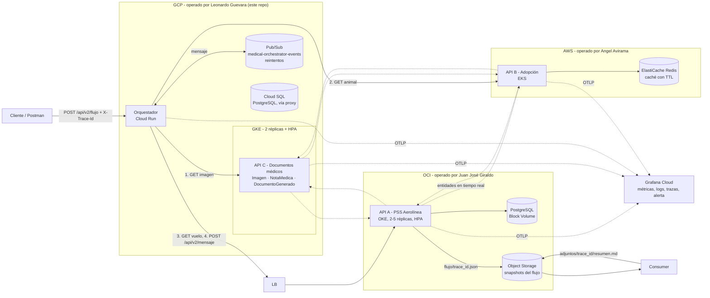

# Medical Documents API

API RESTful académica para gestión de documentos médicos, construida con **Fastify** + **PostgreSQL**, con versionado, 2 ambientes independientes (Pruebas y Producción), pipelines CI/CD con quality gates, e integración multicloud con los equipos de Juan José Giraldo y Angel Avirama.

Repositorio: https://github.com/LeonardoG2005/MedicalDevops

## Entidades

| Entidad | Descripción | Relación |
|---|---|---|
| **Imagen** | Imagen médica (radiografía, resonancia, etc.) | Raíz de la cadena |
| **NotaMedica** | Nota clínica asociada a una imagen | `imagen_id → imagenes.id` |
| **DocumentoGenerado** | Documento (PDF, reporte) generado a partir de una nota médica | `nota_medica_id → notas_medicas.id` |

```
imagenes ──< notas_medicas ──< documentos_generados
```

Ambas relaciones son `NOT NULL` con `ON DELETE CASCADE` - borrar una imagen borra en cascada sus notas y documentos.

## Arquitectura general del grupo

El proyecto integra 3 APIs independientes, cada una en una nube distinta, coordinadas por un orquestador asíncrono vía Pub/Sub. Este repositorio implementa **API C** (documentos médicos) y el **orquestador**.



| Integrante | Nube | API | Componente transversal |
|---|---|---|---|
| **Leonardo Guevara** | **GCP** (GKE + Cloud Run) | API C: Imagen, NotaMedica, DocumentoGenerado (este repo) | Orquestador + cola Pub/Sub |
| Juan José Giraldo | Oracle OCI (OKE) | API A: Vuelo, Pasajero, AsientoAsignado ([clic_kiusys](https://github.com/juangz1912/clic_kiusys)) | Object Storage + consumidor, capa de observabilidad SaaS |
| Angel Avirama | AWS (EKS) | API B: Animal, Adoptante, Adopción ([Api_Pet_Adoption](https://github.com/AngelAvirama/Api_Pet_Adoption)) | Caché Redis (ElastiCache) |

**Contrato del grupo:** cada API expone un `GET` random por entidad y un `GET` por id que trae, además de la entidad local, una entidad random de cada compañero (integración directa peer-to-peer, sin pasar por el orquestador). El `traceId` (header `X-Trace-Id`) se propaga en toda la cadena, y OpenTelemetry lo vincula con las trazas que llegan a Grafana Cloud.

## Stack técnico

| Capa | Tecnología |
|---|---|
| Framework HTTP | Fastify 5 |
| Base de datos | PostgreSQL (Cloud SQL en producción) |
| Migraciones | Script propio (`scripts/migrate.js`), sin ORM ni CLI externa |
| Observabilidad | OpenTelemetry (trazas, métricas, logs) → OTLP → Grafana Cloud |
| Métricas | `prom-client` compatible, expuestas en `/metrics` (formato Prometheus) |
| Documentación API | OpenAPI 3.0 vía `@fastify/swagger` + `@fastify/swagger-ui` en `/documentation` |
| CI/CD | GitHub Actions - 2 pipelines independientes |
| Contenedores | Docker, imágenes publicadas en Artifact Registry (GCP) |
| Orquestación | Kubernetes (GKE) para la API, Cloud Run para el orquestador |
| Mensajería asíncrona | Google Cloud Pub/Sub |

## Endpoints

### API v1 - CRUD de entidades

| Recurso | Métodos | Notas |
|---|---|---|
| `/imagenes` | `GET`, `POST`, `PUT /:id`, `DELETE /:id` | |
| `/notas-medicas` | `GET`, `POST`, `PUT /:id`, `DELETE /:id`, **`QUERY`** | `QUERY /notas-medicas` filtra por `paciente` (parcial), `fecha` y `imagen_id` en el body |
| `/documentos-generados` | `GET`, `POST`, `PUT /:id`, `DELETE /:id` | |

Todos los payloads se validan contra JSON Schema (AJV, vía Fastify). Las violaciones de llave foránea (`imagen_id`/`nota_medica_id` inexistente) responden `400` controlado, no `500`.

### El verbo QUERY

`QUERY` no es un verbo HTTP estándar en Node - se habilita explícitamente en `src/app.js`:

```js
const http = require('http');
if (!http.METHODS.includes('QUERY')) {
  http.METHODS.push('QUERY');
}
// ...
app.addHttpMethod('QUERY', { hasBody: true, overrideExisting: true });
```

Esto debe ejecutarse **antes** de registrar cualquier ruta que lo use. A diferencia de `GET` (que no permite body de forma estándar), `QUERY` sí lo permite - por eso se usa para filtros complejos que no caben bien en query-string:

```bash
curl -X QUERY http://<host>/notas-medicas \
  -H "Content-Type: application/json" \
  -d '{"paciente": "Ana", "imagen_id": 3}'
```

### API v2 - integración entre pares

| Endpoint | Qué hace |
|---|---|
| `GET /api/v2/imagenes/random` | Imagen aleatoria local |
| `GET /api/v2/notas-medicas/random` | Nota médica aleatoria local |
| `GET /api/v2/documentos-generados/random` | Documento generado aleatorio local |
| `GET /api/v2/imagenes/:id` | Imagen por id + llamada en vivo a la API de Juan (vuelo random) y a la de Angel (animal random), propagando `X-Trace-Id` |

### Observabilidad y sistema

| Endpoint | Qué hace |
|---|---|
| `GET /` | Info básica del servicio |
| `GET /health` | Liveness/readiness check |
| `GET /metrics` | Métricas Prometheus (`http_requests_total`, `http_request_duration_seconds`, métricas default de Node) |
| `GET /documentation` | Swagger UI interactivo |

## Cómo validar la API con Swagger

1. Levanta la API (local, test o producción).
2. Abre `http://<host>/documentation` en el navegador.
3. Cada endpoint documentado tiene botón **"Try it out"** - completa el body/params según el schema mostrado y ejecuta directamente desde el navegador, sin necesidad de Postman/curl.
4. El esquema OpenAPI crudo (si lo necesitas para importar a Postman/Insomnia) está en `http://<host>/documentation/json`.

> Nota: el `servers` del spec está configurado como `/` (relativo), así que Swagger UI arma la URL correcta sin importar si estás en local, test o producción - no hay que editarlo al cambiar de ambiente.

## Ambientes

| | Pruebas | Producción |
|---|---|---|
| Rama que dispara el deploy | `test` | `main` |
| Infraestructura | (Render, vía webhook) | **GKE** (`medical-documents-api`, namespace `default`, 2 réplicas) |
| Base de datos | Postgres propio de Pruebas | Cloud SQL PostgreSQL, vía Cloud SQL Auth Proxy |
| URL | *(la del servicio de Render de Pruebas)* | `http://34.123.58.136` (LoadBalancer de GKE) |
| Variables/secrets | Secrets de Render independientes | `medical-api-secrets` + `medical-api-otel` (GKE Secrets, sincronizados desde Google Secret Manager vía `SecretProviderClass`) |
| Cobertura mínima exigida | ≥ 60% | ≥ 85% |

Ambos ambientes son completamente independientes: distinta base de datos, distintas credenciales, distinta URL pública.

## CI/CD

Dos pipelines independientes en GitHub Actions, uno por ambiente (`.github/workflows/test.yml` y `.github/workflows/production.yml`), ambos con la misma secuencia de *quality gates*:

```
Checkout → Setup Node → Install deps → Migrar BD (npm run db:migrate)
   → Run tests → Coverage gate (c8) → Build imagen Docker → Deploy
```

**Regla de aprobación obligatoria:** si cualquier paso anterior falla (tests con errores, o cobertura por debajo del umbral), GitHub Actions detiene el job automáticamente - el `build` y el `deploy` **nunca se ejecutan**. No hace falta lógica adicional para esto: es el comportamiento por defecto de un job de Actions (cada `step` depende implícitamente de que el anterior haya salido con código 0).

El pipeline de producción (`production.yml`) despliega a GKE: construye la imagen, la publica en Artifact Registry con el tag = SHA del commit, aplica los manifiestos de `k8s/` y actualiza la imagen del Deployment con `kubectl set image` + espera el rollout. Ver el archivo para el detalle completo.

## Kubernetes (producción)

Manifiestos en `k8s/`:

| Archivo | Qué define |
|---|---|
| `deployment.yaml` | Deployment con 2 réplicas, contenedor de la API + sidecar `cloud-sql-proxy`, probes de startup/readiness/liveness sobre `/health` |
| `service.yaml` | `LoadBalancer` con IP fija pública |
| `config-map.yaml` | Variables no sensibles (puerto, `NODE_ENV`, configuración de OTel) |
| `secret-provider-class.yaml` / `secret-sync.yaml` | Sincronizan `DATABASE_URL`, `API_A_URL`, `API_C_URL` desde Google Secret Manager a un Secret de Kubernetes |
| `service-account.yaml` | Service Account de K8s enlazada (Workload Identity) a una cuenta de servicio de GCP |
| `pod-monitoring.yaml` | `PodMonitoring` (Google Cloud Managed Prometheus) scrapeando `/metrics` cada 30s |
| ` hpa.yaml` | `HorizontalPodAutoscaler` que escala automáticamente entre 2 y 5 réplicas según el uso de CPU |

## Observabilidad

- **Trazas y métricas de aplicación:** OpenTelemetry auto-instrumentation (`--require @opentelemetry/auto-instrumentations-node/register`), exportadas vía OTLP a Grafana Cloud. Activo tanto en la API (`OTEL_SERVICE_NAME=api-c-documentos`) como en el orquestador.
- **Métricas de infraestructura:** `PodMonitoring` de GKE scrapea `/metrics` (formato Prometheus) cada 30 segundos.
- **Trace propagation:** header `X-Trace-Id` de negocio en toda la cadena; OpenTelemetry gestiona el `traceparent` W3C real en las llamadas instrumentadas automáticamente.

## Orquestador

El orquestador (`orchestrator/`) vive en el mismo repo pero se despliega por separado en **Cloud Run** (`orchestrator/cloudbuild.yaml`). Expone:

- `POST /api/v2/flujo` - punto de entrada público, publica un mensaje en Pub/Sub y responde `202` de inmediato (asíncrono).
- `POST /internal/pubsub` - *push endpoint* interno que Pub/Sub invoca para procesar cada mensaje (llama en cadena a la API de Leonardo, Angel y Juan).
- `GET /health`, `GET /metrics` - igual que la API principal.

Ver `orchestrator/README.md` (pendiente) para el detalle completo de su arquitectura y variables de entorno.

## Cómo correr en local

```bash
cp .env.example .env
# completa DATABASE_URL, API_A_URL, API_C_URL

npm install
npm run db:migrate
npm run dev
```

O con Docker:

```bash
docker compose up --build
```

## Entidades de referencia del schema

```sql
-- supabase/migrations/001_initial_schema.sql
imagenes (id, nombre, url, fecha_creacion)
notas_medicas (id, paciente, contenido, fecha, imagen_id → imagenes.id)
documentos_generados (id, nombre, tipo, url, fecha_generacion, nota_medica_id → notas_medicas.id)
```

Las migraciones **no** se ejecutan automáticamente al iniciar la app - se ejecutan explícitamente con `npm run db:migrate`, tanto en local como en ambos pipelines de CI, antes de correr los tests. Esto mantiene una separación clara entre "levantar el servicio" y "preparar el esquema de la base de datos".
