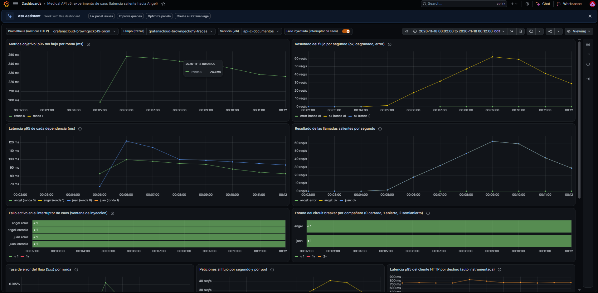
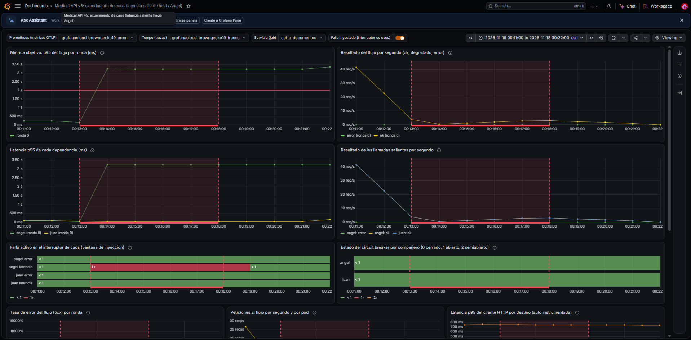
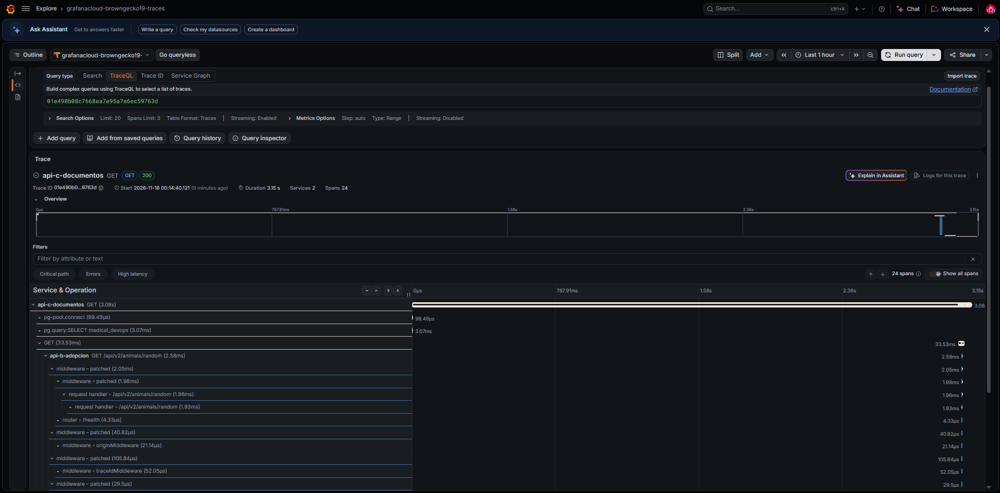
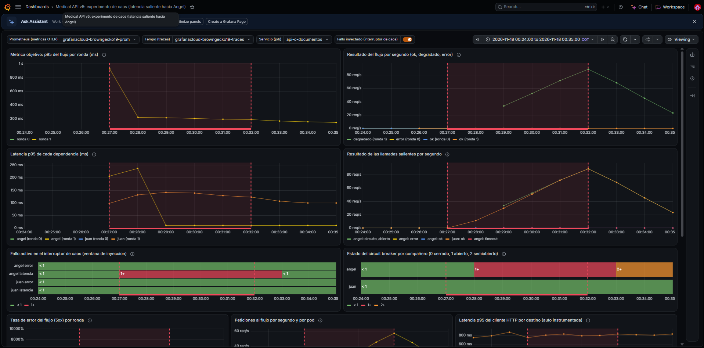
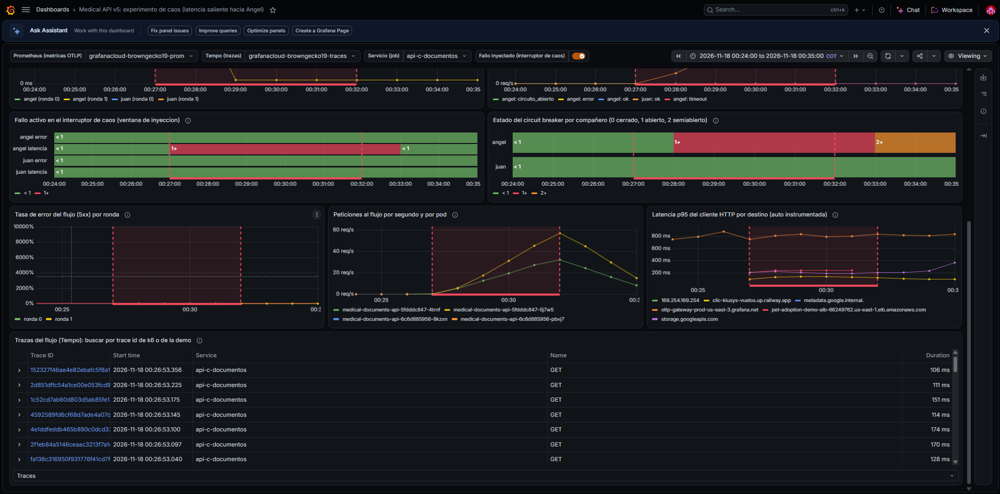
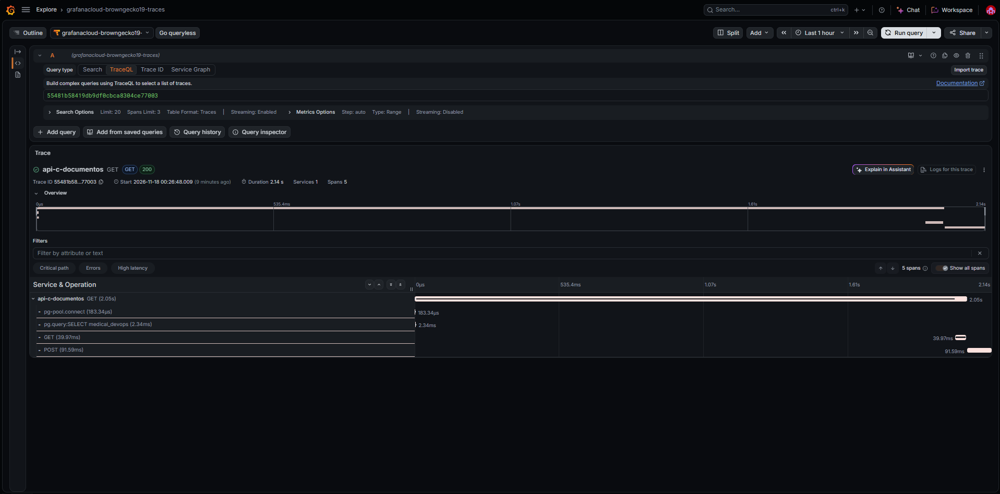
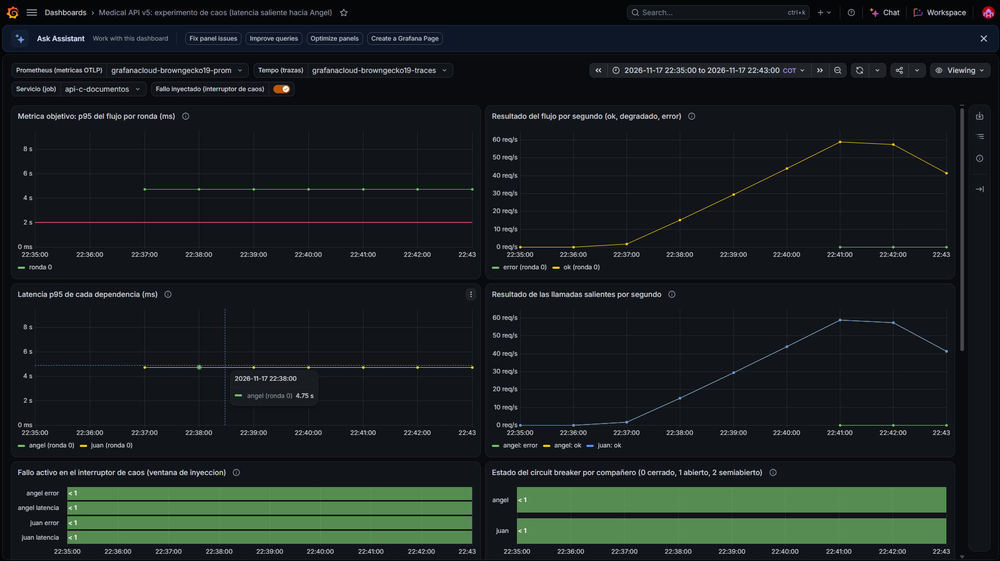
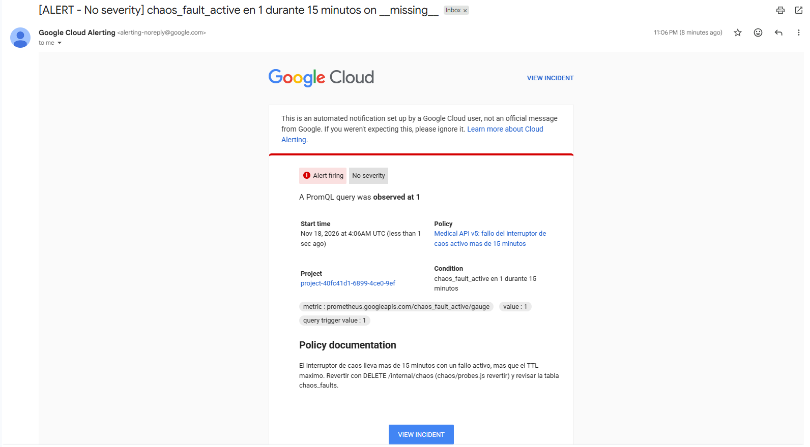

# Informe de experimento: latencia inyectada en la llamada saliente hacia la API de Angel

Medical Documents API (coordinador, GCP / GKE). Release 5, Ingeniería del Caos.
Autor: Leonardo Guevara. Rondas sobre la nube: 2026-11-18, 00:04 a 00:32 hora de Colombia
(05:04 a 05:32 UTC), ejecutadas desde CI (`chaos-gate.yml`) contra el coordinador en GKE con las tres APIs
del grupo en línea. Las rondas locales con dobles (2026-11-16) quedan como ensayo previo (sección 8).

## 1. Sistema y estado estable

El flujo `GET /api/v5/flujo/:imagenId` del coordinador en GKE (2 réplicas fijas) consulta una imagen en
Cloud SQL, llama en cadena a la API de adopción de Angel (AWS, `GET /api/v2/animals/random`), después a la
API de vuelos de Juan (Railway, `GET /api/v2/entidades/vuelos/random`), archiva el resultado en GCS y
responde con las tres entidades, propagando `X-Trace-Id` de punta a punta.

Estado estable medido en la nube con el mismo perfil y el mismo instrumento, sin fallo
([run 44241619755](https://github.com/LeonardoG2005/MedicalDevops/actions/runs/44241619755), modo
`estado-estable` del workflow):

| Indicador | Valor medido (nube, sin fallo) |
|---|---|
| Peticiones en 5 min | 19 392 (64,6 por segundo) |
| p95 / p99 / mediana del flujo | 272 ms / 424 ms / 116 ms |
| Tasa de error | 0,01 % (2 de 19 392) |
| p95 de la dependencia Angel / Juan | 87 ms / 96 ms |
| Respuestas degradadas, circuito abierto | 0 % / 0 % |
| Veredicto de la puerta | APROBADO |

Umbrales declarados antes de medir (`chaos/slo.json`): p95 < 2000 ms, tasa de error < 5 %, mínimo 300
peticiones por ronda. El estado estable cumple con 7 veces de margen en p95.

## 2. Hipótesis

"Dado el perfil de carga P (10 usuarios virtuales en bucle cerrado durante 5 minutos: 30 s de subida,
4 min sostenidos, 30 s de bajada), cuando se inyecten 3000 ms de latencia en la llamada saliente hacia la
API de Angel durante la duración de la carga, el flujo `GET /api/v5/flujo` mantendrá la latencia p95
extremo a extremo por debajo de 2000 ms y la tasa de error por debajo del 5 %."

Métrica objetivo única: **p95 de `http_req_duration` medido por k6** durante los 5 minutos del perfil.
Instrumento: k6 (`chaos/k6/flujo.js`, `handleSummary` a JSON). Ventana de observación: la carga completa.

## 3. Método

| Elemento | Valor |
|---|---|
| Herramienta declarativa | Chaos Toolkit 1.19, `chaos/experiments/latencia-salida-angel.json` |
| Interruptor propio | tabla `chaos_faults` + `POST/DELETE /internal/chaos` con token efímero y TTL (`src/chaos/`) |
| Inyección | `latency_ms=3000` para `peer=angel`, aplicada en `src/v5/peer-client.js` antes de `fetch`, con la misma señal de aborto |
| Carga | k6, perfil fijo, `GET /api/v5/flujo/random` con `X-Trace-Id` por petición |
| Radio de impacto | solo la dependencia `angel` del flujo v5 en los pods del coordinador; nada más se toca |
| Duración | 5 min de carga; TTL del fallo 420 s (reversión automática si la ejecución muere) |
| Condiciones de aborto | k6 detiene la carga si `http_req_failed > 50 %` durante 60 s; `chaos run --rollback-strategy=always` |
| Reversión | `DELETE /internal/chaos/angel`, verificación de lista vacía y de estado estable; paso `if: always()` en CI; TTL |
| Diferencia entre rondas | solo `RESILIENCE_ENABLED` (`false` ronda 0, `true` ronda 1), cambiado con `kubectl patch` del ConfigMap y reinicio |
| Coordinación | ventana sin carga de los compañeros; el workflow verifica `X-Ronda` antes de inyectar |

Orden de ejecución: hipótesis antes, comprobación de que no hay fallos, activación, pausa de 5 s (caché),
petición de muestra, k6, hipótesis después (con el fallo aún activo), rollbacks, puerta de calidad.

## 4. Ronda 0 (sin protecciones)

[Run 44242633122](https://github.com/LeonardoG2005/MedicalDevops/actions/runs/44242633122), 2026-11-18,
fallo activo de 00:12:54 a 00:18:12 (hora de Colombia).

| Métrica | Estado estable | Ronda 0 |
|---|---|---|
| p95 del flujo | 272 ms | **3150 ms** |
| p99 / mediana | 424 ms / 116 ms | 3218 ms / 3137 ms |
| Máximo | 860 ms | 3436 ms |
| Tasa de error | 0,01 % | 0 % |
| Peticiones en 5 min | 19 392 (64,6/s) | 865 (2,9/s) |
| p95 de la dependencia Angel / Juan | 87 ms / 96 ms | 3038 ms / 47 ms |
| Hipótesis después del fallo | | **refutada** (sonda `flujo` 3225 ms > 2000 ms, `deviated: true`) |
| Rollbacks | | 3 de 3 exitosos |
| Puerta de calidad | APROBADO | **RECHAZADO** (el workflow termina en rojo) |

### Modo de fallo observado y diagnóstico

Toda la latencia del compañero se suma al flujo: el coordinador espera los 3000 ms antes de llamar a Angel,
luego llama a Juan, y el usuario recibe la respuesta completa pero tardía. Con 10 usuarios en bucle cerrado
el throughput cae de 64,6 a 2,9 peticiones por segundo (cada usuario queda bloqueado unos 3 s por
petición): es **saturación por esperas sin límite**, el primer paso de un fallo en cascada. No hubo errores
porque no existía ningún timeout: la ausencia de errores es precisamente el síntoma de que nada protegía
al flujo. Si la dependencia hubiera respondido 5xx en lugar de tardar, el flujo habría devuelto 502 sin
llamar a Juan (`test/v5.flujo.test.js`, "si Angel falla el flujo responde 502 y no llama a Juan").

La traza de Tempo localiza la causa. Una petición de la ronda (3,15 s, 2 servicios, 24 spans) muestra la
consulta a Cloud SQL (3 ms), la llamada a Angel de 34 ms y, dentro de ella, los spans de servidor de su API
(`api-b-adopcion`, 2,6 ms). Angel no está lento: los 3 s son la espera inyectada en nuestra llamada
saliente, antes de enviar la petición, que es exactamente el radio de impacto declarado.

## 5. Mejora aplicada

Elegida a partir del diagnóstico (latencia, no error):

1. **Timeout por dependencia (2000 ms)**: `AbortSignal.timeout` compartido por la espera inyectada y
   `fetch`. Acota el costo máximo de un compañero lento.
2. **Circuit breaker por compañero** (opossum: 5 llamadas, 50 % de fallos, 10 s de reposo): tras los
   primeros timeouts deja de llamar a Angel y el flujo responde de inmediato; cada 10 s prueba una llamada.
3. **Degradación elegante**: el flujo completa la cadena (sigue llamando a Juan) y responde 200 con
   `animal: null` y `degradado: true` en lugar de 502.

Descartado a propósito: reintentos. Contra una latencia, reintentar duplica la presión sobre el compañero
lento y la latencia propia (tormenta de reintentos). El coordinador no reintenta en ninguna ronda.

## 6. Ronda 1 (con protecciones)

[Run 44244223691](https://github.com/LeonardoG2005/MedicalDevops/actions/runs/44244223691), 2026-11-18,
fallo activo de 00:26:28 a 00:31:39, mismo código, mismo fallo, mismo perfil, mismo instrumento,
`RESILIENCE_ENABLED=true`.

| Métrica | Ronda 0 | Ronda 1 | Variación |
|---|---|---|---|
| p95 del flujo | 3150 ms | **193 ms** | -93,9 % |
| p99 del flujo | 3218 ms | 401 ms | -87,5 % |
| Mediana | 3137 ms | 94 ms | -97,0 % |
| Máximo | 3436 ms | 2397 ms (los primeros timeouts) | -30,2 % |
| Tasa de error | 0 % | 0 % | sin cambio |
| Peticiones en 5 min | 865 (2,9/s) | 24 380 (81,3/s) | x 28 |
| Respuestas degradadas | 0 % | 100 % | |
| Circuito abierto | 0 % | 99,8 % de las peticiones | |
| Hipótesis después del fallo | refutada | **se mantiene** (sonda `flujo` 200 en 131 ms) | |
| Puerta de calidad | RECHAZADO | **APROBADO** | |

Conclusión: la hipótesis se mantiene en la ronda 1. El tablero muestra la secuencia: un pico inicial de
p95 cercano a 1 s mientras las primeras llamadas expiran a los 2 s, el circuito de Angel se abre
(estado 1) y desde ahí el flujo deja de esperar: p95 alrededor de 200 ms, 100 % de respuestas degradadas y
0 % de errores. Al terminar el fallo el circuito queda semiabierto (estado 2), listo para cerrar con la
siguiente llamada.

Las trazas de la ronda 1 muestran las dos fases de la protección. Antes de abrir el circuito, una petición
dura 2,14 s y **no tiene spans de Angel**: la llamada se abortó a los 2 s durante la espera, nunca salió de
GKE, y el flujo siguió con Juan (40 ms) y el archivo en GCS (92 ms). Con el circuito abierto, una petición
dura 98 ms y tampoco llama a Angel (traza `00ff022c53fd934730d434c7f93fa934`, 00:31:13).

El costo es visible y aceptado: durante el fallo ningún usuario recibe el animal. Comparado con la ronda 0,
el usuario recibe imagen y vuelo en 0,2 s en lugar de las tres entidades en 3,2 s.

## 7. Hallazgos inesperados

- **El throughput lo gobierna la latencia del compañero.** Con la misma carga, la ronda 1 atiende 28 veces
  más peticiones que la ronda 0 y supera incluso al estado estable (81,3 contra 64,6 por segundo), porque
  con el circuito abierto el flujo se ahorra la llamada a Angel. Un timeout ausente es un problema de
  capacidad, no solo de latencia.
- **El tablero mentía en p95** (primera ejecución en la nube, 2026-11-17,
  `chaos/results/nube/corrida-1/`). Los paneles de p95 de Grafana mostraban 4,75 s planos en las tres
  rondas, mientras k6 medía 250, 3127 y 178 ms. Causa: los histogramas de OpenTelemetry usaban los límites
  por defecto del SDK, pensados para milisegundos (0, 5, 10, 25...), y nuestros valores están en segundos:
  todo caía en el primer bucket y `histogram_quantile(0.95)` devolvía 0,95 x 5. La copia de Prometheus
  tampoco distinguía 3 s (saltaba de 2,5 a 5). Se corrigió con límites en segundos densos alrededor de
  2 y 3 s en los dos histogramas (`LATENCY_BUCKETS`, `test/metrics.buckets.test.js`) y se repitieron las
  tres rondas. La puerta nunca dependió del tablero: mide con k6, por eso sus veredictos no cambiaron.

  

- **Una alerta llegó por correo y era falsa.** En la primera ejecución, la alerta "fallo del interruptor
  activo más de 15 minutos" se disparó a las 23:06 aunque el fallo había durado 5 minutos y la tabla
  estaba vacía. Cada pod solo refrescaba su caché del interruptor cuando recibía peticiones; al terminar
  la carga, un pod sin tráfico siguió publicando `chaos_fault_active = 1`. Se corrigió con un refresco
  periódico de 5 s (`CHAOS_CACHE_REFRESH_MS`, `test/chaos.cache.test.js`) y se verificó en GKE: con un
  fallo de prueba de 1 ms y sin tráfico, los dos pods bajaron a 0 en 9 s tras la reversión. En la
  repetición de las rondas no llegó ninguna alerta falsa. El hallazgo tiene una parte buena: el canal de
  correo de las alertas funciona de punta a punta.

  

- **El primer despliegue desde CI disparó una alerta de seguridad.** `deploy-gke.yml` ejecuta la
  migración como un job de Cloud Run con la cuenta del coordinador, y el robot de Cloud Run aparece en los
  logs de auditoría como delegación de esa identidad: la regla de suplantación lo marcó como crítico. Es
  actividad legítima; la corrección propuesta es una cuenta de servicio propia para la migración.
- **El circuito no cierra solo sin tráfico.** Tras la ronda 1 queda semiabierto hasta que llega una
  petición que lo pruebe. Es el comportamiento de opossum y no afecta al usuario: la primera petición real
  lo cierra si el compañero ya responde.
- **El workflow nunca había corrido.** La primera ejecución de la puerta falló en la validación porque
  `chaos validate` exige la variable `CHAOS_TOKEN` aunque no llame a nada; también faltaba el modo de token
  efímero que el coordinador usa desde el game day de seguridad. Ninguno de los dos defectos aparecía en
  las rondas locales.

## 8. Ensayo local previo (2026-11-16)

Antes de la nube se ensayó el mismo experimento contra dobles de los compañeros
(`chaos/mocks/peer-mock.js`): ronda 0 p95 3046 ms (refutada, RECHAZADO), ronda 1 p95 12 ms (se mantiene,
APROBADO). Evidencia en `chaos/results/` (k6, diario y puerta por ronda). La dirección y el orden de
magnitud coinciden con la nube; las diferencias (12 frente a 193 ms) son la red real y Cloud SQL.

## 9. Backlog de resiliencia

| Pendiente | Por qué |
|---|---|
| Estado del circuit breaker compartido entre réplicas (Memorystore) | hoy cada pod abre su propio circuito |
| Mamparo de concurrencia por dependencia | un compañero lento podría agotar el pool de peticiones del pod antes de que el breaker abra |
| Caché del último animal conocido para degradar con datos y no con `null` | durante el fallo el 100 % de las respuestas pierde el animal |
| Cuenta de servicio propia para la migración | evita la alerta de suplantación en cada despliegue |
| Autoscaling (HPA max > 2) después del experimento | se fijó en 2 para comparar rondas con capacidad idéntica |

## 10. Evidencia de observabilidad

- Resultados versionados de las rondas en la nube: `chaos/results/nube/` (k6, diario de Chaos Toolkit y
  veredicto de la puerta de cada ronda) y `chaos/results/nube/corrida-1/` (primera ejecución, con los dos
  defectos del tablero).
- Tablero de Grafana Cloud (`chaos/grafana/dashboard-caos.json`):
  https://browngecko19.grafana.net/d/medical-caos-v5. Capturas en `docs/chaos/img/`.
- Tablero de Cloud Monitoring (Terraform, `terraform/chaos.tf`) sobre Managed Prometheus; da los mismos
  p95 que k6 con los buckets corregidos (241 ms en el estado estable).
- Trazas en Tempo correlacionadas por petición; el `traceId` también aparece en los logs del pod junto con
  `trace_id` y `span_id`, y viaja a las APIs de los compañeros en `X-Trace-Id`.

## 11. Apoyo de IA (opcional de la rúbrica)

Se usó Claude (Anthropic) para auditar el repositorio, proponer la asignación de fallos, redactar el
experimento, el generador de carga, los patrones, esta estructura de informe y para diagnosticar los dos
defectos de observabilidad encontrados en la nube. Se descartó de lo propuesto: reintentos con retroceso
exponencial (amplifican una latencia), un tablero único en lugar de dos (el grupo ya usa Grafana Cloud y la
cátedra pide evidencia reproducible como código, de ahí Terraform), parchear variables de entorno del
Deployment como mecanismo de inyección (reinicia pods durante la medición) y usar el tablero como fuente de
la puerta (k6 es el instrumento declarado; el tablero resultó tener un defecto).
