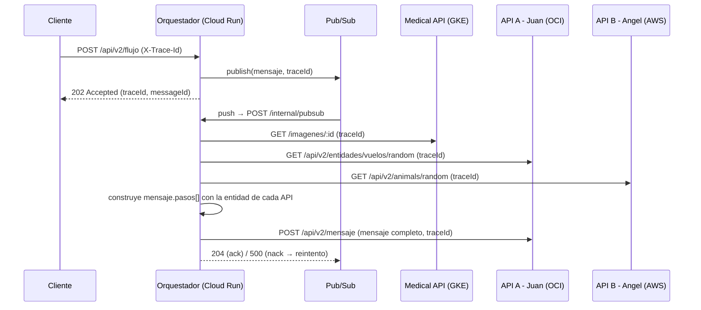

# Medical Orchestrator

Servicio de orquestación asíncrona del grupo - coordina el flujo de un mensaje a través de las 3 nubes (GCP, AWS, OCI), usando Google Cloud Pub/Sub como cola de mensajería y reproceso.

Repositorio: https://github.com/LeonardoG2005/MedicalDevops (carpeta `orchestrator/`)

## Rol en la arquitectura

Este es el **componente transversal** que le corresponde a Leonardo Guevara dentro del grupo (orquestación). Los otros dos componentes transversales - caché (Angel, AWS) y almacenamiento de objetos (Juan, OCI) - viven en sus propios repositorios. Ver el diagrama completo en el [README raíz](../README.md).



## Endpoints

| Endpoint | Método | Qué hace |
|---|---|---|
| `/api/v2/flujo` | `POST` | Punto de entrada público. Recibe la petición del cliente, publica un mensaje en Pub/Sub con un `traceId` (propio o heredado de `X-Trace-Id`/`traceparent`), y responde `202 Accepted` de inmediato - el procesamiento es asíncrono, no se espera a que termine. |
| `/internal/pubsub` | `POST` | *Push endpoint* - lo invoca únicamente Pub/Sub cuando hay un mensaje nuevo en la suscripción. Decodifica el mensaje (base64), valida que tenga `traceId`, y ejecuta el flujo completo (`flow-processor`). Si falla, responde `500`, lo que hace que Pub/Sub reintente la entrega (reproceso automático); cada reintento se cuenta en `orchestrator_queue_messages_reprocessed_total`. |
| `/health` | `GET` | Liveness check (`{ status: 'ok' }`). |
| `/metrics` | `GET` | Métricas en formato Prometheus. |

## El flujo (`flow-processor.js`)

Por cada mensaje procesado, el orquestador:

1. Llama en tiempo real a la Medical API (GCP), a la API de Juan (OCI) y a la de Angel (AWS), propagando el `traceId` en cada llamada.
2. Acumula la respuesta de cada una en `mensaje.pasos[]` - cada API queda representada por su propio objeto de entidad dentro del mensaje final (no se pierde la trazabilidad de quién aportó qué).
3. Hace `POST` del mensaje completo a la API de Juan (`/api/v2/mensaje`), que es quien lo persiste en Object Storage (OCI).

Como cada llamada es en tiempo real (no hay copia ni caché de los datos de los compañeros en el orquestador), si alguien modifica un dato en su API mientras el flujo corre, el siguiente mensaje que pase por ahí refleja el cambio.

## Métricas expuestas

| Métrica | Tipo | Qué mide |
|---|---|---|
| `orchestrator_flows_total{status}` | Counter | Flujos completados / fallidos |
| `orchestrator_flow_duration_seconds` | Histogram | Duración de un flujo completo |
| `orchestrator_external_request_duration_seconds{service,status}` | Histogram | Latencia de cada llamada saliente (por servicio) |
| `orchestrator_queue_messages_pending` | Gauge | Mensajes publicados y aún no completados |
| `orchestrator_queue_messages_reprocessed_total` | Counter | Mensajes redelivered por Pub/Sub tras un fallo previo |
| `http_requests_total` / `http_request_duration_seconds` | Counter / Histogram | Tráfico HTTP propio del orquestador (p50/p95 vía `histogram_quantile` en Grafana) |

Todas también se emiten en paralelo vía OpenTelemetry (`orchestrator.flows`, `orchestrator.flow.duration`, etc.) hacia Grafana Cloud.

## Variables de entorno

```bash
PORT=4000
MEDICAL_API_URL=       # URL de la Medical API (GCP)
API_A_URL=             # URL de la API de Juan (OCI)
API_C_URL=             # URL de la API de Angel (AWS)
GCP_PROJECT_ID=
PUBSUB_TOPIC=medical-orchestrator-events
```

## Cómo correr en local

```bash
cd orchestrator
cp .env.example .env
npm install
npm start
```

## Tests

```bash
cd orchestrator
npm test
```

## Despliegue

El orquestador se despliega de forma **independiente** al resto del monorepo, directo a **Cloud Run** vía **Cloud Build**:

```bash
gcloud builds submit --config orchestrator/cloudbuild.yaml .
```

`cloudbuild.yaml` construye la imagen con el `Dockerfile` propio de esta carpeta, la publica en Artifact Registry, y la despliega como servicio de Cloud Run en `us-central1`. No comparte pipeline con la Medical API - cada componente transversal del grupo versiona y despliega el suyo por separado.